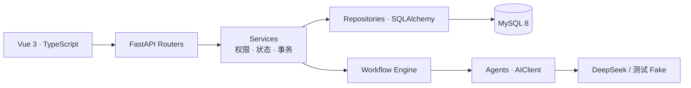
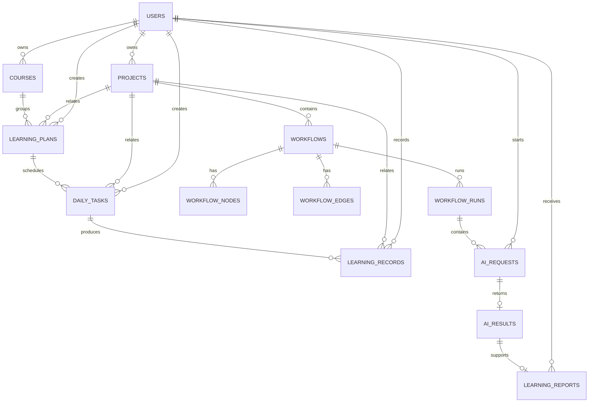
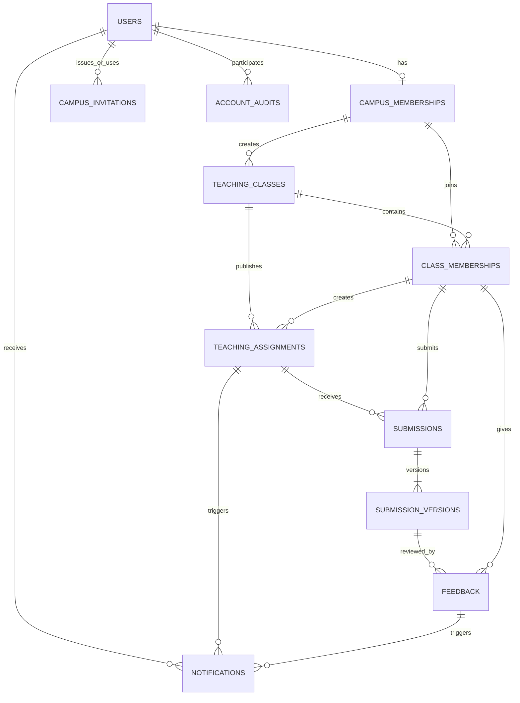
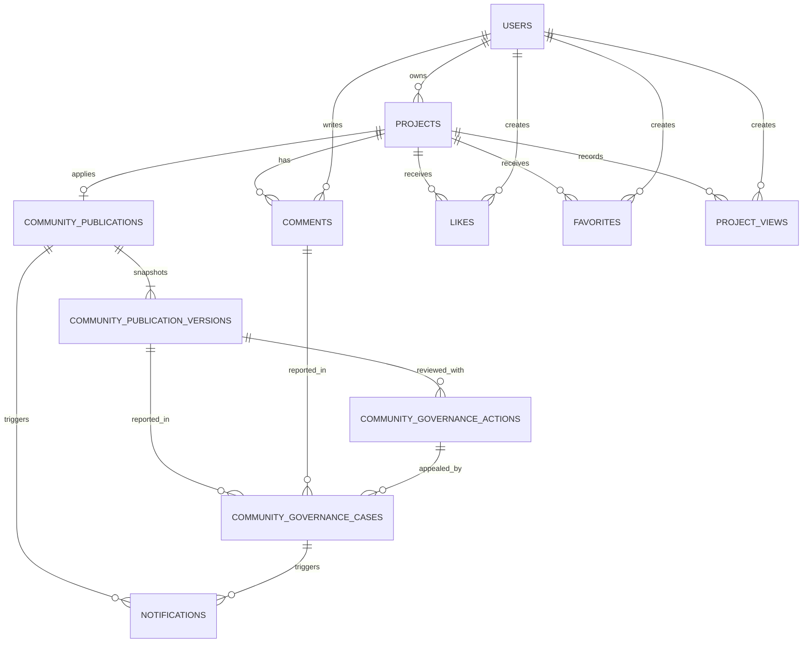

<p align="center">
  
</p>

# ScholarHub

**AI 辅助校园学习与代码实践平台**

从一个项目开始，把学习计划、AI 分析、动手实践和教学反馈连起来。ScholarHub 面向高校学生与教师：学生可以管理个人项目，编排 AI 工作流并记录学习过程；教师可以发布任务、查看分版本提交并给出反馈，让每次修改都有迹可循。

<p>
  <a href="#功能亮点">功能亮点</a> ·
  <a href="#界面预览">界面预览</a> ·
  <a href="#快速开始">快速开始</a> ·
  <a href="#技术实现">技术实现</a> ·
  <a href="#验证与进展">验证与进展</a> ·
  <a href="#文档导航">文档导航</a>
</p>

## 功能亮点

- **项目实践**：管理项目目标、技术栈、状态与进度，从项目库进入个人实践空间。
- **个人学习**：组织课程、学习计划、每日任务与学习记录，把长期目标拆成每天的行动。
- **AI 工作台与工作流**：编辑项目 Context，获取需求分析与开发 Prompt；用节点和连线组织 AI 分析、提示、讲解与静态评审。
- **教学任务与反馈**：教师发布任务，学生提交 V1、V2 等不可覆盖的版本，教师逐版退回修改或确认通过。
- **校园作品社区**：通过发布申请与人工审核展示作品，支持评论、点赞、收藏、举报和复核。
- **数据与复盘**：查看学习及项目统计，生成并保存带有生成时事实快照的 AI 学习报告。

一次典型的实践过程是：**创建项目 → 安排学习任务 → 用 AI 辅助分析或练习 → 自主实现 → 提交版本并获得反馈 → 记录与复盘**。

## 界面预览

当前界面采用 Campus Studio 设计：森林绿、纸白与清晰的内容层次。以下均为当前前端页面的浏览器截图，展示数据为演示样例；点击图片可查看原图。

### 学习从一个项目开始

[](开发相关文档/测试证据/20261014-规范优化/desktop-home.png)

<table>
  <tr>
    <td width="50%" valign="top">
      <strong>项目库</strong><br>
      项目状态、技术栈与进度集中展示。
      <a href="开发相关文档/测试证据/20261014-规范优化/desktop-projects.png"></a>
    </td>
    <td width="50%" valign="top">
      <strong>课程与学习计划</strong><br>
      关联课程与项目，持续跟进学习目标。
      <a href="开发相关文档/测试证据/20261014-规范优化/desktop-learning.png"></a>
    </td>
  </tr>
  <tr>
    <td width="50%" valign="top">
      <strong>可视化 AI 工作流</strong><br>
      编排节点、编辑配置，组织分析与练习。
      <a href="assets/readme/workflow.png"></a>
    </td>
    <td width="50%" valign="top">
      <strong>提交版本与教师反馈</strong><br>
      保留退回、修订与通过的完整过程。
      <a href="assets/readme/feedback.png"></a>
    </td>
  </tr>
</table>

<details>
<summary>查看更多：数据分析与手机端</summary>

**数据分析与学习报告**


**手机端首页**


</details>

## 快速开始

本地验证环境为 Node.js 22.21、pnpm 11.25、Python 3.12 与 MySQL 8。后端要求 Python 3.11+，依赖以 [package.json](frontend/package.json)、[pnpm 锁文件](frontend/pnpm-lock.yaml) 和 [requirements.txt](backend/requirements.txt) 为准。

```powershell
git clone https://github.com/lengchang-haoyuan/AI-Assisted-Campus-Learning-and-Code-Practice-Platform.git ScholarHub
cd ScholarHub
```

### 1. 准备后端与数据库

```powershell
cd backend
python -m venv .venv
.\.venv\Scripts\Activate.ps1
python -m pip install -r requirements.txt
Copy-Item .env.example .env
```

编辑 `backend/.env`：

| 配置 | 用途 |
| --- | --- |
| `DATABASE_URL` | MySQL 连接地址，示例格式见 [.env.example](backend/.env.example) |
| `JWT_SECRET` | 自行设置不少于32个字符的随机密钥 |
| `DEEPSEEK_API_KEY` | 使用 AI 功能时填写；普通页面和个人管理功能不需要模型密钥 |

为新环境准备空库后，在 `backend` 目录执行初始化。`schema.sql` 使用数据库名 `scholarhub`，连接配置需保持一致；已有业务库请备份并审查 [增量迁移](backend/migrations/) 后升级。

```powershell
mysql --default-character-set=utf8mb4 --user=root --password --execute="source schema.sql"
python -m uvicorn app.main:app --reload --host 127.0.0.1 --port 8000
```

### 2. 启动前端

另开一个终端，在项目根目录执行：

```powershell
cd frontend
pnpm install --frozen-lockfile
Copy-Item .env.example .env
pnpm dev
```

| 入口 | 默认地址 |
| --- | --- |
| 前端 | <http://127.0.0.1:5173> |
| Swagger API 文档 | <http://127.0.0.1:8000/docs> |
| 健康检查 | <http://127.0.0.1:8000/api/v1/health> |

克隆仓库不会导入演示截图中的项目、账号或学习数据。可先注册普通账号体验个人功能；需要 AI 功能时，再配置后端模型密钥。Fake Provider 通过自动化测试注入，用于确定性验证。

### 3. 启用校园教学功能

系统没有默认管理员密码。核验一个现有账号后，在 `backend` 目录初始化首位校园管理员：

```powershell
python -m app.cli.init_campus_admin --user-id <用户编号> --reason "已核验的初始化原因"
```

随后由管理员向教师和学生签发定向邀请，再建立教学班与任务。具体配置与权限说明见 [后端 README](backend/README.md#p17-校园身份初始化)。

## 技术实现

| 层次 | 主要技术 |
| --- | --- |
| 前端 | Vue 3、TypeScript、Vite、Vue Router、Pinia |
| 交互与可视化 | Element Plus、Vue Flow、ECharts |
| 后端 | FastAPI、Pydantic、SQLAlchemy、HTTPX |
| 数据与认证 | MySQL 8、PyMySQL、JWT、Argon2 |
| AI | DeepSeek Provider、结构化 Agent、ProjectContext、有向无环工作流 |

### 系统架构



前端通过统一 API 层访问后端；后端沿用 `Router → Service → Repository → Model` 分层。当前包含 **30个页面、96个 OpenAPI 路径、136个接口操作、34张数据表与81个外键约束**，口径截至2026-10-16。

### 值得关注的实现

- **可追踪的 AI 执行**：6类可运行节点，支持结构化结果、运行历史和失败续跑；Context 按字段和版本管理，执行输入变化会使受影响节点失效。
- **并发与旧结果保护**：运行中禁止修改执行图，提交结果时核对图与 Context 版本；模型等待期间不持有数据库事务。
- **完整的学习与反馈记录**：计划完成以真实任务状态为依据；提交版本与反馈保留历史，教学来源由真实关联关系确认。
- **账号与权限边界**：服务端校验身份、资源归属与校园角色；退出账号销毁私人状态，异步列表仅接收最新请求结果。

<details>
<summary>查看数据模型与 ER 图</summary>

## 数据模型与 ER 图

完整定义以 [SQLAlchemy Models](backend/app/models/) 与 [schema.sql](backend/schema.sql) 为准。ProjectContext 当前作为 `projects` 的版本化 JSON 字段保存，因此没有单独的 `project_contexts` 表。

### 个人学习与 AI



### 校园身份、教学任务与提交



### 校园社区治理



关键边界：个人 `Course`、`DailyTask`、`Project` 与教学班数据分开；教师权限来自有效 `CampusMembership + ClassMembership`，不是姓名字符串；管理员管理账号、班级元数据和公开内容，不默认读取私人 Context、学习笔记、AI 输入或教学提交正文。

</details>

### 代码导航

| 入口 | 作用 |
| --- | --- |
| [frontend/src/views/](frontend/src/views/) | 路由页面与业务界面 |
| [frontend/src/api/](frontend/src/api/)、[stores/](frontend/src/stores/) | 接口调用、认证与领域状态 |
| [frontend/src/domain/workflow.ts](frontend/src/domain/workflow.ts) | 工作流画布与图校验 |
| [frontend/src/styles/campus-studio.css](frontend/src/styles/campus-studio.css) | 当前界面主题与响应式样式 |
| [backend/app/api/v1/](backend/app/api/v1/)、[services/](backend/app/services/) | API 入口、权限与业务编排 |
| [backend/app/agents/](backend/app/agents/)、[workflow/](backend/app/workflow/) | AI Agent、Context 投影与工作流执行 |
| [backend/app/models/](backend/app/models/)、[repositories/](backend/app/repositories/) | 数据模型与持久化访问 |
| [backend/schema.sql](backend/schema.sql)、[migrations/](backend/migrations/) | 新环境建库与增量迁移 |

## 验证与进展

2026-10-16 完成 CR1–CR9 严格审查整改，覆盖工作流并发、Context、账号隔离、请求竞态、学习计划、可信来源、校园身份与教学分页。

| 已完成的验证 | 结果 |
| --- | --- |
| 后端 `unittest` | **271项通过** |
| 前端类型检查与生产构建 | 通过；保留 Analytics 分包体积提示 |
| 隔离 MySQL 主线与专项并发/事务验收 | 通过，测试数据清理后为0行 |
| 真实 API 浏览器主线 | **150次 API 请求，0个页面脚本错误** |

可复核的命令、日志与验收矩阵见 [CR9最终验收报告](开发相关文档/阶段报告/20261016-CR9-严格审查整改最终验收报告.md)；最近一次提交前复查见 [GitHub检查与推送报告](开发相关文档/阶段报告/20261016-GitHub检查与推送报告.md)。以上为本地技术验收记录。

常用检查命令：

```powershell
# 项目根目录：后端测试
cd backend
.\.venv\Scripts\python.exe -B -m unittest discover -s tests -q

# 前端类型与构建
cd ..\frontend
pnpm typecheck
pnpm build
```

### 后续方向

- **AI 质量与成本**：统一额度、预算、并发与质量评测，见 [P22检查点](开发相关文档/阶段报告/20260911-P22-现状检查与实施待确认.md)。
- **上线与真实教学试点**：生产配置、备份恢复、隐私流程及真实师生课程周期验证，见 [P23检查点](开发相关文档/阶段报告/20260911-P23-现状检查与实施待确认.md) 与 [P24试点方案](开发相关文档/AI提示词/P24_真实班级试点.md)。
- **规划中的扩展**：[AI引导式分步实践](开发相关文档/开发规划/20261014-AI引导式工作流改进方案与验收目标.md) 与 [Spark离线分析](开发相关文档/开发规划/20261015-ScholarHub大数据毕业设计后续计划与实施方法.md)，目前处于方案阶段。

当前适合本地演示与继续开发。AI 评审为静态建议，平台不执行学生代码；统一生产保障和真实班级试点仍待完成。

## 文档导航

| 想了解什么 | 从这里开始 |
| --- | --- |
| 项目定位与业务范围 | [项目说明](开发相关文档/AI辅助校园学习与代码实践平台_项目说明文档.md) |
| 开发资料与过程记录 | [文档索引](开发相关文档/README.md)、[操作日志](开发相关文档/开发日志/开发操作日志.md) |
| 功能交付与验证证据 | [阶段报告](开发相关文档/阶段报告/)、[测试证据](开发相关文档/测试证据/) |
| AI 辅助开发的阶段设计 | [AI提示词索引](开发相关文档/AI提示词/README.md) |
| 学习材料与源码导览 | [学习材料](开发相关文档/学习材料/)、[知识地图](开发相关文档/知识网络/00-ScholarHub知识地图.md) |
| 演示与答辩 | [原型逐页演示指南](开发相关文档/答辩材料/ScholarHub原型逐页演示指南.md) |

```text
ScholarHub/
├── frontend/           Vue 界面、API、Store 与工作流画布
├── backend/            FastAPI、数据模型、Agent 与执行引擎
├── assets/readme/      仓库首页封面与当前页面截图
├── 开发相关文档/       规划、学习材料、日志、验收与答辩资料
└── README.md           项目入口
```
