<p align="center">
  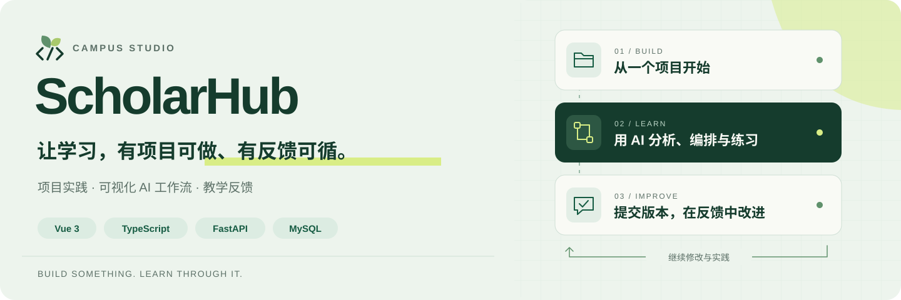
</p>

# ScholarHub

**AI 辅助校园学习与代码实践平台**

从一个项目开始，把学习计划、AI 分析、动手实践和教学反馈连起来。ScholarHub 面向高校学生与教师：学生可以管理个人项目，编排 AI 工作流并记录学习过程；教师可以发布任务、查看分版本提交并给出反馈，让每次修改都有迹可循。

面向**数据科学与大数据技术**毕业设计，项目进一步将现有学习、任务、提交与教师反馈组织为可复核的数据链：**MySQL 一致性快照 → ODS → PySpark 清洗关联 → Spark SQL 指标 → 不可变批次 → 本人只读 API**。截至 **2026-10-20，V2 S00–S05 已完成**；图表页面接入与综合分析验收是下一阶段 S06。

<p>
  <a href="#功能亮点">功能亮点</a> ·
  <a href="#界面预览">界面预览</a> ·
  <a href="#快速开始">快速开始</a> ·
  <a href="#技术实现">技术实现</a> ·
  <a href="#大数据离线分析">大数据离线分析</a> ·
  <a href="#关键代码节点">关键代码节点</a> ·
  <a href="#核心调用链">核心调用链</a> ·
  <a href="#er-diagrams">ER图</a> ·
  <a href="#验证与进展">验证与进展</a> ·
  <a href="#文档导航">文档导航</a>
</p>

## 功能亮点

- **项目实践**：管理项目目标、技术栈、状态与进度，从项目库进入个人实践空间。
- **个人学习**：组织课程、学习计划、每日任务与学习记录，把长期目标拆成每天的行动。
- **AI 工作台与工作流**：编辑项目 Context，获取需求分析与开发 Prompt；用节点和连线组织 AI 分析、提示、讲解与静态评审。运行历史支持“运行记录 → 单个节点”两级导航，需求、技术栈、架构及教学结果分别阅读。
- **教学任务与反馈**：教师发布任务，学生提交 V1、V2 等不可覆盖的版本，教师逐版退回修改或确认通过。
- **校园作品社区**：通过发布申请与人工审核展示作品，支持评论、点赞、收藏、举报和复核。
- **数据与复盘**：保留原实时统计与 AI 学习报告；新增独立的 Spark 离线分析，提供数据质量分流、可信教学关联、学习过程专题与本人发布批次查询。

一次典型的实践过程是：**创建项目 → 安排学习任务 → 用 AI 辅助分析或练习 → 自主实现 → 提交版本并获得反馈 → 记录与复盘**。

## 界面预览

界面采用 Campus Studio 设计：森林绿、纸白与清晰的内容层次。以下为阶段验收时的浏览器截图，展示数据为演示样例；点击图片可查看原图。

### 学习从一个项目开始

[](开发相关文档/测试证据/20261014-规范优化/desktop-home.png)

<table>
  <tr>
    <td width="50%" valign="top">
      <strong>项目库</strong><br>
      项目状态、技术栈与进度集中展示。
      <a href="开发相关文档/测试证据/20261014-规范优化/desktop-projects.png">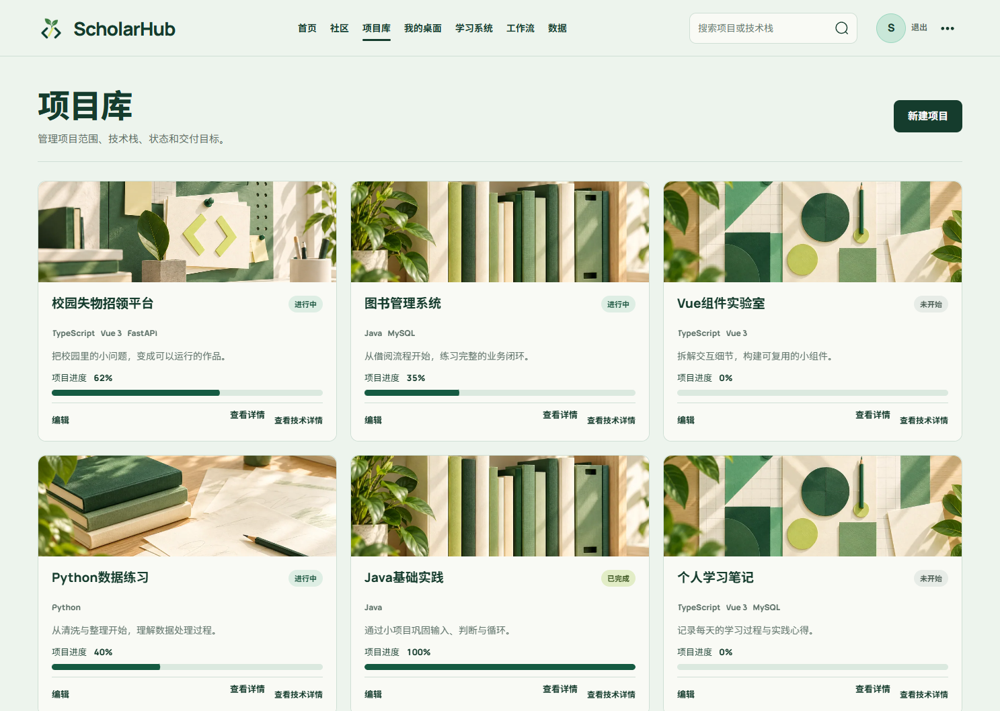</a>
    </td>
    <td width="50%" valign="top">
      <strong>课程与学习计划</strong><br>
      关联课程与项目，持续跟进学习目标。
      <a href="开发相关文档/测试证据/20261014-规范优化/desktop-learning.png">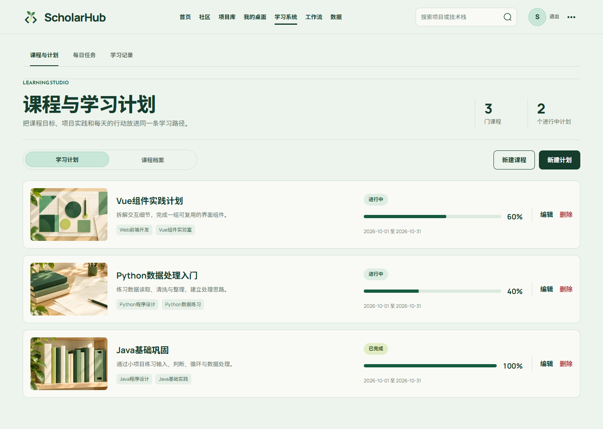</a>
    </td>
  </tr>
  <tr>
    <td width="50%" valign="top">
      <strong>可视化 AI 工作流</strong><br>
      编排节点、编辑配置，组织分析与练习。
      <a href="assets/readme/workflow.png">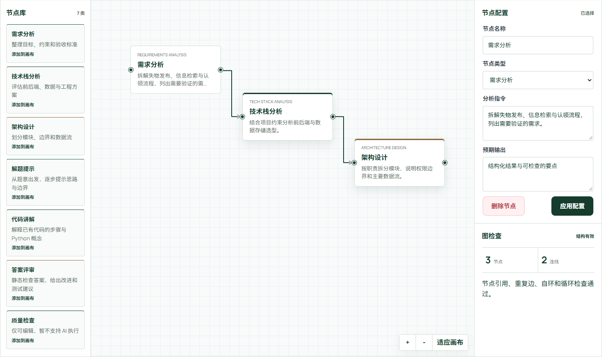</a>
    </td>
    <td width="50%" valign="top">
      <strong>提交版本与教师反馈</strong><br>
      保留退回、修订与通过的完整过程。
      <a href="assets/readme/feedback.png">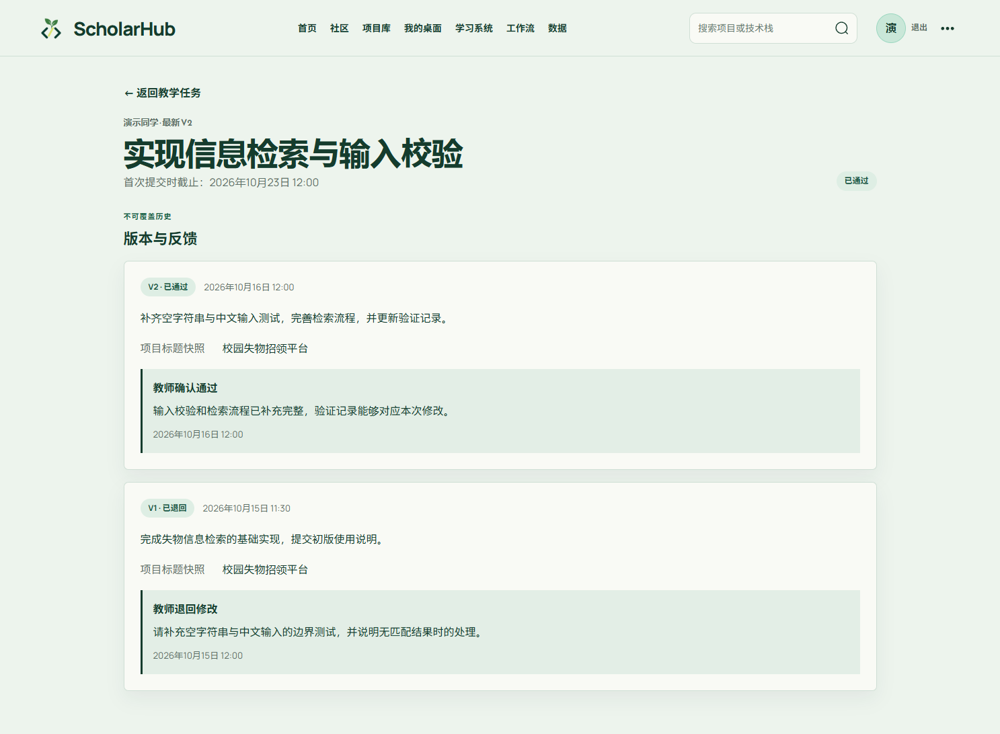</a>
    </td>
  </tr>
</table>

### 运行记录内独立查看节点结果

运行历史、节点列表与详情各自保留选择；需求按说明和验收项组织，架构按模块与数据流展示，运行统计保留耗时/Token 的零值与缺失含义。下图使用固定 Mock 数据验证交互，条图表达数量，不代表 AI 质量评分。

[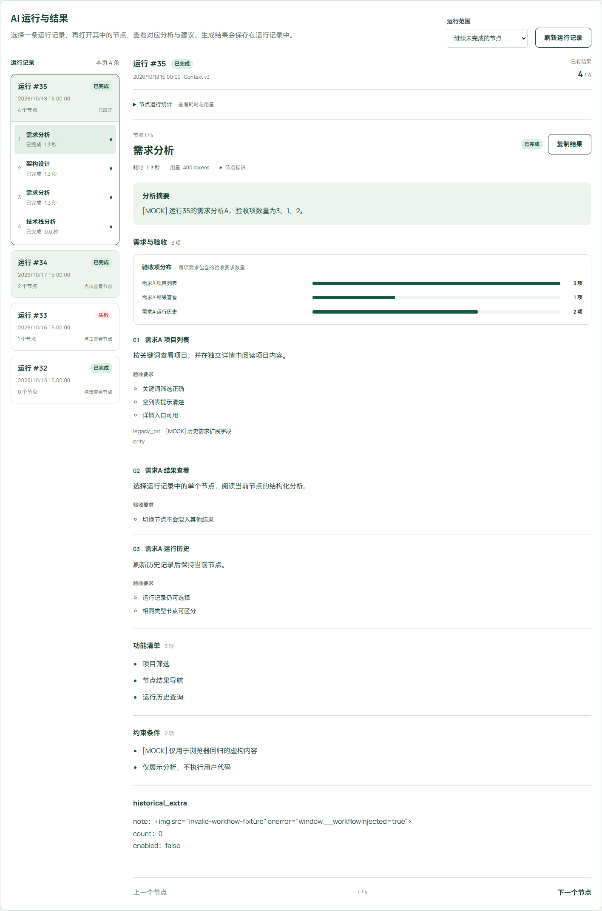](开发相关文档/测试证据/20261018-工作流结果/mock-desktop-requirements.png)

<details>
<summary>查看更多：数据分析与手机端</summary>

**数据分析与学习报告**

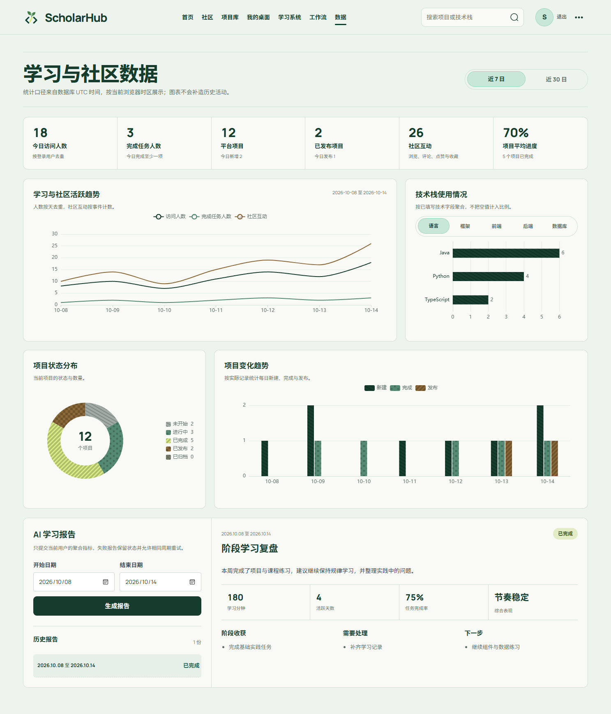

**手机端首页**

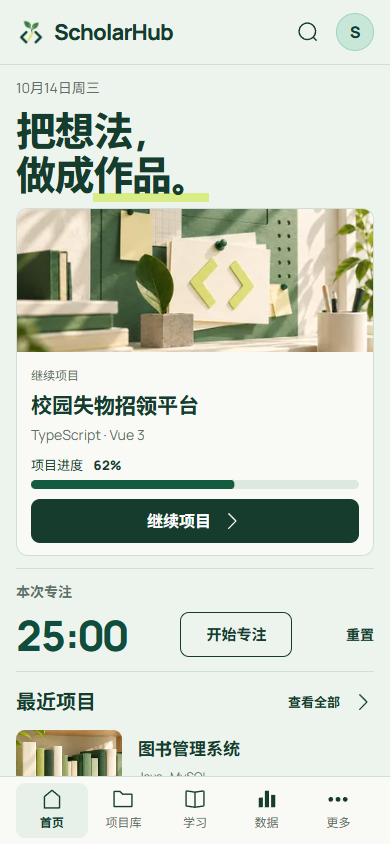

</details>

## 快速开始

本地验证环境为 Node.js 22.21、pnpm 11.25、Python 3.12 与 MySQL 8。后端要求 Python 3.11+，依赖以 [package.json](frontend/package.json)、[pnpm 锁文件](frontend/pnpm-lock.yaml) 和 [requirements.txt](backend/requirements.txt) 为准。

```powershell
git clone https://github.com/lengchang-haoyuan/AI-Assisted-Campus-Learning-and-Code-Practice-Platform.git ScholarHub
cd ScholarHub
```

### 1. 准备后端与数据库

```powershell
cd backend
python -m venv .venv
.\.venv\Scripts\Activate.ps1
python -m pip install -r requirements.txt
Copy-Item .env.example .env
```

编辑 `backend/.env`：

| 配置 | 用途 |
| --- | --- |
| `DATABASE_URL` | MySQL 连接地址，示例格式见 [.env.example](backend/.env.example) |
| `JWT_SECRET` | 自行设置不少于32个字符的随机密钥 |
| `DEEPSEEK_API_KEY` | 使用 AI 功能时填写；普通页面和个人管理功能不需要模型密钥 |

为新环境准备空库后，在 `backend` 目录执行初始化。`schema.sql` 使用数据库名 `scholarhub`，连接配置需保持一致；已有业务库请备份并审查 [增量迁移](backend/migrations/) 后升级。

```powershell
mysql --default-character-set=utf8mb4 --user=root --password --execute="source schema.sql"
python -m uvicorn app.main:app --reload --host 127.0.0.1 --port 8000
```

### 2. 启动前端

另开一个终端，在项目根目录执行：

```powershell
cd frontend
pnpm install --frozen-lockfile
Copy-Item .env.example .env
pnpm dev
```

| 入口 | 默认地址 |
| --- | --- |
| 前端 | <http://127.0.0.1:5173> |
| Swagger API 文档 | <http://127.0.0.1:8000/docs> |
| 健康检查 | <http://127.0.0.1:8000/api/v1/health> |

克隆仓库不会导入演示截图中的项目、账号或学习数据。可先注册普通账号体验个人功能；需要 AI 功能时，再配置后端模型密钥。Fake Provider 通过自动化测试注入，用于确定性验证。

### 3. 启用校园教学功能

系统没有默认管理员密码。核验一个现有账号后，在 `backend` 目录初始化首位校园管理员：

```powershell
python -m app.cli.init_campus_admin --user-id <用户编号> --reason "已核验的初始化原因"
```

随后由管理员向教师和学生签发定向邀请，再建立教学班与任务。具体配置与权限说明见 [后端 README](backend/README.md#p17-校园身份初始化)。

### 4. 阅读与运行离线分析

普通 Web 功能不要求安装 Spark。离线作业使用独立的 WSL/PySpark 环境，不写入后端 requirements；当前验证环境为 Ubuntu 24.04、Python 3.12.3、PySpark 4.2.0、JDK 17、local[2]。

先看 [analytics 执行入口](analytics/README.md)，再看 [Spark 作业说明](analytics/S04.md) 与 [发布/API契约](开发相关文档/阶段报告/AI大数据改造/V2/S05-发布与接口契约.md)。仓库保留虚构隔离快照、独立答案和完整计算产物，可以离线复核数据及谱系；克隆不会创建它们引用的用户或数据库。

在已配置好的 PySpark 环境、仓库根目录，可用新 job-id 输出到新目录：

```bash
python -B -m analytics.spark_job \
  --input '开发相关文档/阶段报告/AI大数据改造/V2/S03-ODS/snapshots/s03-owner3-restored' \
  --output ./analytics-output \
  --job-id local-review-001
```

成功 job-id 不可复用。`analytics-output` 是本例本地输出目录，勿将它当成新的受控发布来源直接导入。当前发布 CLI 明确限定本轮已批准隔离库与两份完成任务；新环境需先核对账号归属、源样本与迁移目标，不能照搬虚构用户编号。实际命令和恢复边界见 [后端离线分析说明](backend/README.md#s05-离线分析发布与本人只读接口)。

## 技术实现

| 层次 | 主要技术 |
| --- | --- |
| 前端 | Vue 3、TypeScript、Vite、Vue Router、Pinia |
| 交互与可视化 | Element Plus、Vue Flow、ECharts |
| 后端 | FastAPI、Pydantic、SQLAlchemy、HTTPX |
| 数据与认证 | MySQL 8、PyMySQL、JWT、Argon2 |
| AI | DeepSeek Provider、结构化 Agent、ProjectContext、有向无环工作流 |
| 离线分析 | WSL、PySpark 4.2.0、Spark SQL、JSONL ODS、Parquet DWD/ADS、版本化发布批次 |

### 系统架构

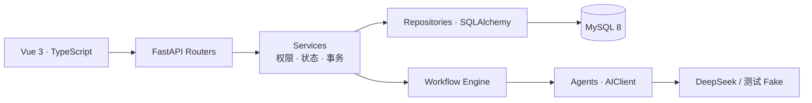

前端通过统一 API 层访问后端；后端沿用 `Router → Service → Repository → Model` 分层。截至2026-10-20，当前源码包含 **30个页面文件、98个 OpenAPI 路径、138个接口操作、36张数据表与83个外键约束**。表/外键以 ORM 为准，两张新增分析表目前仅在专用隔离库完成实际迁移；已有业务库需另行审查迁移，不能仅更新代码就认定数据库已升级。

### 值得关注的实现

- **可追踪的 AI 执行**：6类可运行节点，支持结构化结果、运行历史和失败续跑；Context 按字段和版本管理，执行输入变化会使受影响节点失效。
- **并发与旧结果保护**：运行中禁止修改执行图，提交结果时核对图与 Context 版本；模型等待期间不持有数据库事务。
- **完整的学习与反馈记录**：计划完成以真实任务状态为依据；提交版本与反馈保留历史，教学来源由真实关联关系确认。
- **账号与权限边界**：服务端校验身份、资源归属与校园角色；退出账号销毁私人状态，异步列表仅接收最新请求结果。
- **可信数据分析**：固定输入、独立答案、质量对账与 Spark SQL 聚合分开；完成批次不可覆盖，普通图表 GET 只读已发布结果。

## 大数据离线分析

### 分析问题与技术分工

首个专题是**提交修订与教师确认进展**：固定窗口内有哪些首次提交，哪些发生修订，哪些获得教师确认，哪些仍待评阅？分钟与活跃日提供背景，任务及提交反馈描述过程，不将它们直接转换成学习能力分数。

| 层次 | 职责 | 当前实现 |
| --- | --- | --- |
| MySQL 业务源 | 保存学习记录、任务、版本与反馈，处理权限和事务 | 既有10张核心来源表；AI请求9字段独立辅助白名单 |
| ODS | 在一个受控一致性事务窗口抽取白名单字段 | 完整窗口快照、manifest、主体/时区/截止/版本；更新删除重新抽取 |
| DWD | 清洗类型、区分重复与冲突、验证归属和关系 | record/task/cohort 三类事实及 AI 辅助 Parquet；异常与质量计数 |
| ADS | 使用 Spark SQL 形成日汇总、专题和规则证据 | 三类指标、精确分母、来源计数、等待分布、触发及反例 |
| 发布/MySQL汇总 | 保存完成批次与每日结果，支持稳定低延迟查询 | 两张独立分析表；幂等、行锁、失败回滚、完成历史不可变 |
| API/展示 | 认证本人读取固定批次 | 两个GET已实现；Vue/ECharts离线页面待S06接入 |

MySQL 承担业务事实与发布结果查询，Spark 承担离线清洗、多表关系核验、聚合及实验，两者职责不同。作业是当前机器上的单机 Spark 实验，不能据此宣称已经部署分布式集群。

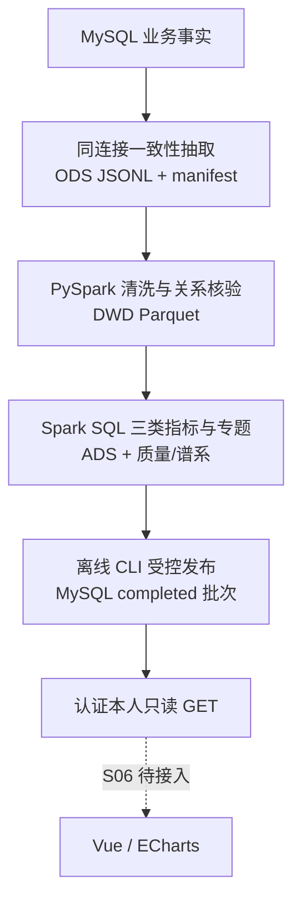

### 三类指标及正确性边界

| 指标 | 保留事实 | 关键口径 |
| --- | --- | --- |
| 记录背景 | 已记录分钟、已知/缺失时长数、零分钟、活跃日、来源分类 | NULL与0独立；教学通过记录不补造学习时长 |
| 任务过程 | completed/全部保留任务、cancelled、逾期未完 | 取消仍入分母；199/200=99.500000%；无任务为无样本 |
| 提交与反馈 | V1群组、修订、教师确认、首次/修订后确认、待评、首次反馈等待与覆盖 | 固定V1窗口，按快照截止读取已保存版本事实；不推断未保存的历史日状态 |

教学来源必须由 **ACCEPT Feedback → 提交版本 → 学生归属 → learning_record_id** 的真实关系证明，`record_metadata.source` 声明不能升级可信来源。提交版本保存说明、仓库 URL 与 ref；可变仓库引用不是不可变代码快照。教师确认与 AI 静态评审、学生自测声明分别记录。

记录时间按 UTC 瞬间转换到业务日，`scheduled_date` 直接保留 DATE。每个结论保留样本量、分子分母、日期和 DWD 定位。重复完全相同行计数去重，同键冲突及错误关联阻止完成；不靠任意挑一行或丢掉异常制造漂亮结果。

### 当前结果与实验

| 数据/验证 | 已获得的结果 |
| --- | --- |
| 主受控样本 | 4条记录，已知75分钟/2条、缺失2条、活跃2日；任务2/4、取消1、逾期未完1；提交群组3、修订1、教师确认2、待评1 |
| 边界受控样本 | 199/200保持99.500000%，与主用户分开，不混算分母 |
| 固定答案 | 15个数据案例及多主体M01在真实Spark与独立Python下核对；D13/D14发布/权限另在S05验证 |
| 规模输入 | 1万唯一学习记录、100个合成主体；用于实验，不是线上用户规模 |
| 规模运行 | 同口径结果一致；本机一次Spark计算25.9026秒、另列启动3.1189秒，Python读取0.0781秒+计算0.6591秒；小数据Python更快 |
| 发布正确性 | 冻结答案、ADS、发布表与API一致；失败不暴露部分结果，重试/重放不增行，两种双连接并发顺序通过 |

以上规模耗时来自[S04固定参数实验](开发相关文档/阶段报告/AI大数据改造/V2/S04-完成报告.md)，尚不是多轮冷热中位数或分布式加速结论。输入先由驱动读取，当前不宣称可承载超出驱动内存的规模。三轮复验、页面解释和综合分析留S06；正式J1解释评分及真实模型质量仍需独立评价。

### 发布、查询与页面职责

| 入口 | 含义 |
| --- | --- |
| `GET /api/v1/offline-analytics/batches?dataset_kind=controlled&page=1&page_size=20` | 本人completed批次；可按1–90日周期筛选，size≤50 |
| `GET /api/v1/offline-analytics/batches/{batch_id}` | 同一完整批次的元信息、daily、三类汇总和quality；不接受详情局部日期过滤 |

列表默认 `dataset_kind=business`；当前演示来源是 `controlled`，因此默认列表为空是正常状态。`empty_reason` 分别表达无完成批次、周期未匹配和页码超出。本人空批次仍先鉴权，未登录401，他人/不存在/未完成404，非法参数422；管理员也不能读取他人分析。

普通 GET 不启动 Spark、模型或发布，不回写业务记录。原 `/statistics` 继续提供实时聚合，新接口只读历史完成批次；同一页面应固定 batch_id，避免不同版本/窗口混算。

AI 项目准备页继续维护事实与 Context，高级工作流继续保留画布和历史。新的实践工作台、等待学生提交会话和建议应用按 S07–S10 实施；它们不是当前Spark数据链的依赖。当前[正式批次交接](开发相关文档/阶段报告/AI大数据改造/V2/S05-S06交接索引.json)明确标出主/边界及应排除的测试fixture。

## 关键代码节点

以下链接直接定位当前实现的文件与函数。建议先看入口和身份，再沿工作流或教学链路阅读；本节中的代码均摘自当前源码。

### 1. 应用入口、认证与会话

| 代码入口 | 关键符号 | 职责与阅读重点 |
| --- | --- | --- |
| [frontend/src/main.ts](frontend/src/main.ts#L1) | `模块入口` | 挂载 Vue、Pinia、Router 与全局样式 |
| [frontend/src/router/index.ts](frontend/src/router/index.ts#L1) | `模块入口` | 声明业务路由，处理登录态和管理员入口守卫 |
| [frontend/src/api/client.ts](frontend/src/api/client.ts#L1) | `模块入口` | 统一请求、认证头与错误处理；旧请求的401不能清掉新账号会话 |
| [frontend/src/stores/auth.ts](frontend/src/stores/auth.ts#L67) | `logout` | 退出后完整导航，销毁私人 Store 与旧页面上下文 |
| [backend/app/main.py](backend/app/main.py#L1) | `模块入口` | 组装 FastAPI、中间件、业务路由和异常处理 |
| [backend/app/api/deps.py](backend/app/api/deps.py#L129) | `get_current_user` | 组装会话与身份依赖，调用认证服务解析当前用户 |
| [backend/app/services/auth.py](backend/app/services/auth.py#L62) | `get_current_user` | 校验账号启用状态与 auth_version，撤销旧凭据 |
| [backend/app/services/campus.py](backend/app/services/campus.py#L344) | `redeem_invitation` | 核验邀请目标、角色、有效期和签发者，处理校园身份兑换 |
| [backend/app/core/database.py](backend/app/core/database.py#L47) | `get_session_factory` | 统一 Session 配置；事务由业务和持久化操作明确收尾 |

### 2. AI 与工作流执行

| 代码入口 | 关键符号 | 职责与阅读重点 |
| --- | --- | --- |
| [frontend/src/composables/useWorkflowExecution.ts](frontend/src/composables/useWorkflowExecution.ts#L43) | `start` | 发起运行、刷新历史和轮询；请求中断后先查询服务端状态 |
| [backend/app/api/v1/workflows.py](backend/app/api/v1/workflows.py#L100) | `run_workflow` | 接收 expected_version 与运行模式，转换请求/响应 |
| [backend/app/services/workflow.py](backend/app/services/workflow.py#L248) | `run_workflow` | 执行前校验工作流归属，并交给执行引擎 |
| [backend/app/workflow/engine.py](backend/app/workflow/engine.py#L116) | `run` | 构造 DAG 执行计划，检查依赖、预算、超时并逐节点执行 |
| [backend/app/api/deps.py](backend/app/api/deps.py#L253) | `build_workflow_registry` | 注册6类可运行 Agent，复用 AIClient 与运行参数 |
| [backend/app/context/context_manager.py](backend/app/context/context_manager.py#L156) | `get_node_policy` | 约束每类节点读取、写入哪些 Context 字段 |
| [backend/app/agents/base.py](backend/app/agents/base.py#L100) | `_build_messages` | 将有效字段集合投影到最终模型消息，并声明输入为不可信数据 |
| [backend/app/ai/client.py](backend/app/ai/client.py#L53) | `complete` | 统一 Provider 调用、超时、有界重试和调用结果 |
| [backend/app/repositories/workflow.py](backend/app/repositories/workflow.py#L94) | `lock_for_edit` | 按 Project→Workflow→Run 边界加锁，拒绝活动运行期间改图 |
| [backend/app/repositories/workflow_execution.py](backend/app/repositories/workflow_execution.py#L191) | `complete_node` | 校验图/Context版本，原子保存结果并失效项目内受影响节点 |
| [backend/app/repositories/workflow_execution.py](backend/app/repositories/workflow_execution.py#L313) | `finish_run` | 重新核对版本及节点状态，避免旧执行覆盖新状态 |

### 3. 学习、教学与社区业务

| 代码入口 | 关键符号 | 职责与阅读重点 |
| --- | --- | --- |
| [backend/app/services/learning.py](backend/app/services/learning.py#L217) | `update_plan` | 用真实任务计数决定完成资格，不用四舍五入后的百分比判断 |
| [backend/app/repositories/learning.py](backend/app/repositories/learning.py#L44) | `lock_task_plans` | 协调计划完成与任务增加、迁移等并发集合变化 |
| [frontend/src/stores/learning.ts](frontend/src/stores/learning.ts#L105) | `fetchTasks` | 同一资源只允许最新请求更新数据、错误和 loading |
| [backend/app/services/teaching.py](backend/app/services/teaching.py#L683) | `publish_assignment` | 校验教师和班级状态，发布任务并生成通知 |
| [backend/app/services/submission.py](backend/app/services/submission.py#L174) | `submit` | 校验学生、任务、截止时间与版本号，保存不可覆盖的提交内容 |
| [backend/app/services/submission.py](backend/app/services/submission.py#L393) | `feedback` | 核对班级教师、最新版本和 revision，保存反馈及关联学习记录 |
| [backend/app/services/community.py](backend/app/services/community.py#L180) | `request_publication` | 从私人项目生成待审核的公开版本快照 |
| [backend/app/services/community.py](backend/app/services/community.py#L392) | `decide_publication` | 管理员审核发布、拒绝或下架，保存治理动作 |
| [backend/app/services/community.py](backend/app/services/community.py#L683) | `decide_case` | 处理举报/复核并保留处理原因和审计关联 |
| [backend/app/services/learning_report.py](backend/app/services/learning_report.py#L73) | `generate` | 用同一次聚合快照生成报告，再覆盖模型输出中的六项事实指标 |
| [backend/app/repositories/learning_report.py](backend/app/repositories/learning_report.py#L40) | `collect_source` | 按用户、日期和时区聚合课程、任务、项目及 AI 使用数据 |

### 4. 三处关键实现摘录

**最终消息按字段投影**：不是只在页面上隐藏字段，而是在序列化给模型时用 `include=context_fields` 限定可见范围。完整 Context 仍用于服务端版本和状态处理。

```python
context_json = json.dumps(
    {
        "context_version": context.version,
        "values": context.values.model_dump(mode="json", include=context_fields),
    },
    ensure_ascii=False,
    sort_keys=True,
    separators=(",", ":"),
)
```

**节点结果提交前核对图版本**：`complete_node` 在锁边界内读取当前图；函数后续还核对 Context 版本并在同一事务保存结果与失效状态。以下摘录保留实际检查语句。

```python
run, workflow, project = self._lock_run(run_id)
if workflow.version != expected_workflow_version:
    raise WorkflowGraphVersionError
```

**完成计划使用真实任务数**：即使界面把199/200显示为约100%，只要还有未完成任务，就不能把计划切为已完成。空计划同样不能完成。

```python
if changes["status"] == LearningPlanStatus.COMPLETED:
    total, completed = self._repository.get_plan_task_counts(plan.id, user_id)
    if total == 0 or completed != total:
        raise ConflictError("仍有未完成任务或计划为空，不能完成学习计划")
    plan.progress = 100
```

### 5. 大数据与分析发布

| 代码入口 | 关键符号 | 职责与阅读重点 |
| --- | --- | --- |
| [backend/scripts/export_ods_snapshot.py](backend/scripts/export_ods_snapshot.py) | `export_snapshot` | 单连接一致性读取与白名单投影，事务结束后写文件 |
| [analytics/snapshot_files.py](analytics/snapshot_files.py) | `publish_snapshot` | 临时目录与完成快照分开，完成ID不可覆盖 |
| [analytics/spark_quality.py](analytics/spark_quality.py) | `normalize / relationship_errors` | 显式Schema、类型/主键/关系校验、质量分流 |
| [analytics/learning_process.sql](analytics/learning_process.sql) | Spark SQL视图 | 三事实先独立聚合再关联，防止一对多放大；准确NULL/DATE/分母 |
| [analytics/spark_job.py](analytics/spark_job.py) | `run_job` | 固定输入/任务/版本，DWD/ADS与质量、谱系及完成目录 |
| [analytics/verify_s04.py](analytics/verify_s04.py) | 独立验证入口 | 冻结答案、Python基线、规模与故障验证，不参与被测聚合 |
| [backend/app/services/analytics_artifacts.py](backend/app/services/analytics_artifacts.py) | `load_publication` | 只从受控任务清单解析完成产物，核对ADS、归属、版本与质量 |
| [backend/app/services/analytics.py](backend/app/services/analytics.py) | `publish / get_batch` | 发布校验、完成重放与只读本人详情分开 |
| [backend/app/repositories/analytics.py](backend/app/repositories/analytics.py) | `reserve / lock / replace_unpublished_daily` | 唯一身份、RR快照边界、批次行锁、失败回滚和完成保护 |
| [backend/app/api/v1/analytics.py](backend/app/api/v1/analytics.py) | 两个GET | 复用认证与DTO，不接受客户端owner或服务器路径 |
| [frontend/src/components/WorkflowNodeResultContent.vue](frontend/src/components/WorkflowNodeResultContent.vue) | 节点内容组件 | 当前工作流需求/选型/架构/教学结果的结构化展示 |

## 核心调用链

### 1. 从画布到 AI 结果

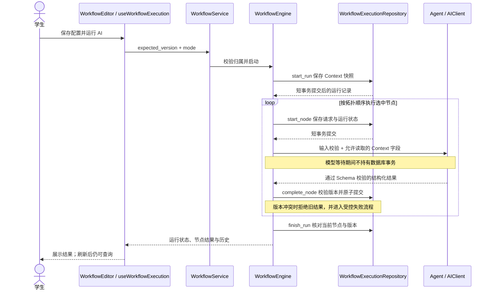

`incomplete` 选择未成功或已失效节点继续执行，`all` 重新运行全部节点。Context 或执行输入更新会传播失效状态；已保存的历史请求和结果保留。

| 可运行节点 | 类型标识 | 主要用途 |
| --- | --- | --- |
| 需求分析 | `requirements_analysis` | 拆解目标、约束和验收要求 |
| 技术栈分析 | `tech_stack_analysis` | 分析技术选型与项目适配 |
| 架构设计 | `architecture_design` | 整理模块、职责和数据流 |
| 解题提示 | `exercise_hint` | 给出分步思路和边界提示 |
| 代码讲解 | `code_explanation` | 解释输入代码与相关概念 |
| 答案评审 | `answer_review` | 静态检查、提出改进和测试建议 |

画布中的“质量检查”目前可编辑但不能执行；条件连线也不参与当前执行引擎。答案评审不执行学生代码。

### 2. 从教学任务到版本反馈

1. 教师通过 `TeachingService.publish_assignment` 发布任务，系统保存任务状态并通知班级成员。
2. 学生通过 `SubmissionService.submit` 提交，按 `request_key` 与预期最新版本处理重复请求和版本竞争；提交内容写入 `submission_versions`。
3. 班级教师通过 `SubmissionService.feedback` 核对 revision 并评阅最新版本，保存反馈、版本状态和通知。退回后学生新增下一版，不能覆盖上一版内容。
4. `accept` 在同一业务事务中创建教学学习记录，并由 `feedback.learning_record_id` 建立可信关联；记录的 `duration_minutes` 保持 `NULL`，教师通过不会自动完成个人项目或每日任务。

前端对应 [SubmissionDetailView.vue](frontend/src/views/SubmissionDetailView.vue) 的版本历史与评阅界面，列表与班级入口分别位于 [SubmissionsView.vue](frontend/src/views/SubmissionsView.vue) 和 [ClassroomDetailView.vue](frontend/src/views/ClassroomDetailView.vue)。

### 3. 从任务状态到学习报告

- **任务与计划**：计划/任务更新先校验归属、日期与项目关联，再用真实计数更新进度。计划完成与任务集合变化共用锁边界，避免完成时又插入未完成任务。
- **报告快照**：`collect_source` 先采集本次来源，`generate` 将同一份数据交给 Agent。总学习时长、活跃天数、任务完成率、项目平均进度、工作流成功率和 AI 请求数由服务端以该快照覆盖保存，后续新增记录不会重写旧报告。
- **普通记录与教学记录**：普通创建/编辑不能伪造 `source`、`submission_id`、`version_number`；教学来源和编辑保护依据真实 Feedback 关系。

### 4. 从私人项目到公开作品

`CommunityService.request_publication → 公开版本快照 → decide_publication 人工审核 → 社区展示`。举报与复核经 `report / appeal / decide_case` 流转；公开状态、版本、治理动作和案件分开记录，私人项目 Context 不直接作为公开内容暴露。

<a id="er-diagrams"></a>

## 数据模型与 ER 图

按业务域拆成七张图，社区部分分为互动与治理两张，另列离线分析；合计覆盖当前36张表。以下图直接展示，不需要展开折叠区。

`PK` 为主键，`FK` 为外键，`UK` 为单列唯一约束，`nullable` 表示可空。字段类型按模型语义简化，图中只保留关键字段与主要关联；完整复合外键、唯一约束和审计字段以 [Models](backend/app/models/)、[schema.sql](backend/schema.sql) 和 [增量迁移](backend/migrations/) 为准。

同一个跨域实体会在不同图中重复出现。空心圆表示可选关系，鸟爪表示多条记录；是否可空和是否唯一来自当前模型约束。

### 1. 账号与校园身份

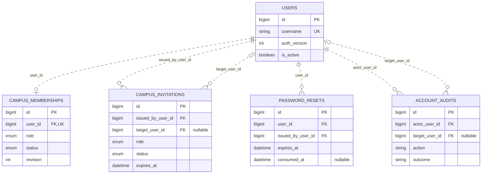

一个用户最多有一条校园身份；校园角色与普通账号状态分别维护。邀请和密码重置仅保存摘要及状态，账号操作留存审计。

主要模型：[backend/app/models/campus.py](backend/app/models/campus.py)。

### 2. 项目与个人学习

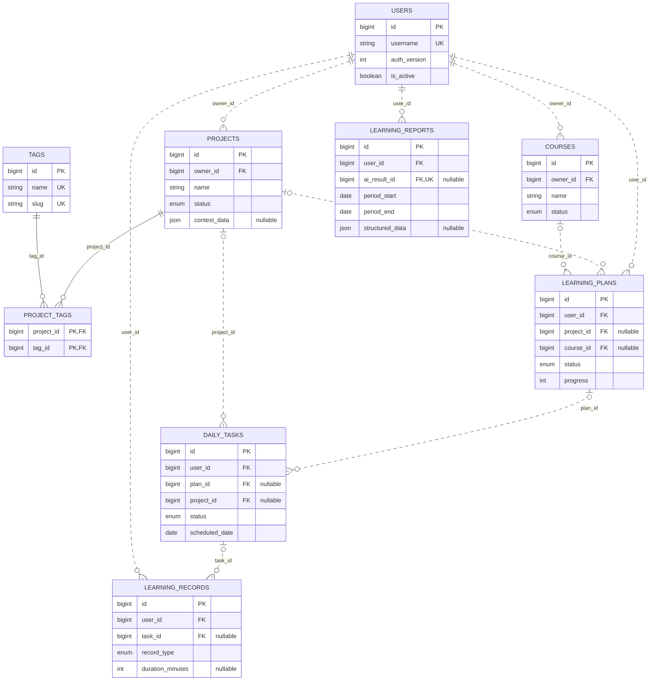

Course 是个人课程，不等同于教学班。任务、计划、项目和学习记录可以按业务规则关联，但教师评阅不替学生完成个人任务；时长未知时保持 NULL。

主要模型：[backend/app/models/learning.py](backend/app/models/learning.py)。

### 3. AI 请求与工作流

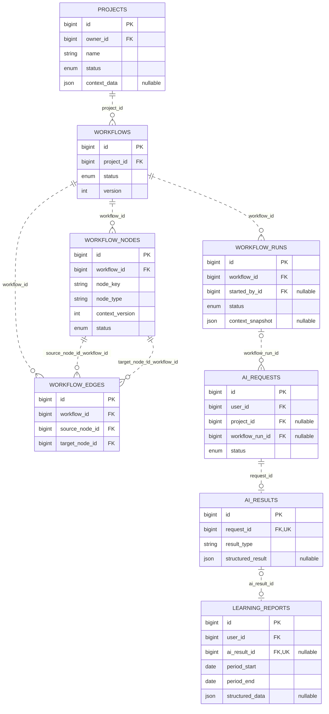

ProjectContext 保存在 projects.context_data 中，没有单独的 project_contexts 表。工作流边通过复合外键保证起点和终点属于同一工作流；运行保存 Context 快照，请求和结果分开存储。

主要模型：[backend/app/models/workflow.py](backend/app/models/workflow.py)。

### 4. 教学任务、提交与反馈

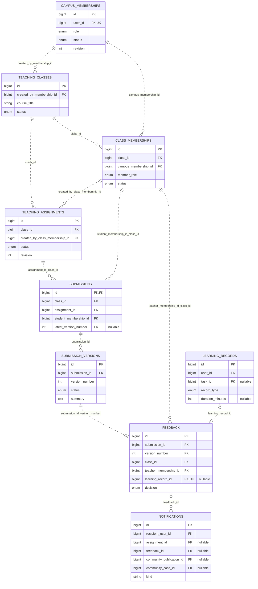

submissions 保存当前提交头，submission_versions 保存不可覆盖的提交内容。每版最多一条反馈；教师通过时可关联一条教学学习记录。班级范围由复合外键和服务端角色校验共同约束。

主要模型：[backend/app/models/submission.py](backend/app/models/submission.py)。

### 5. 校园作品社区互动

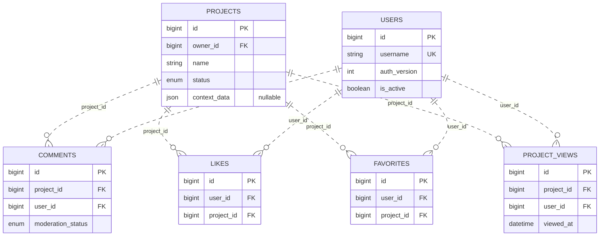

评论、点赞、收藏与浏览记录围绕作品保存，公开访问仍需检查作品发布及治理状态。用户和项目关联是实际外键，不依据显示名称判断归属。

主要模型：[backend/app/models/community.py](backend/app/models/community.py)。

### 6. 作品公开版本与社区治理

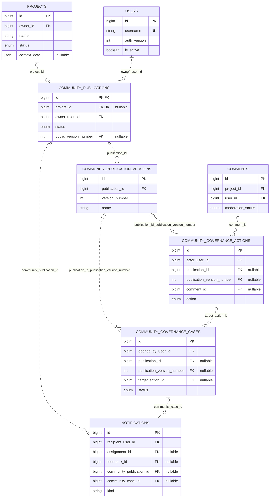

公开展示读取 publication_versions 中的版本快照。publication 保存当前公开/待审核版本指针；治理动作和举报/复核案件分别记录，保留处理依据及审计历史。

主要模型：[backend/app/models/community.py](backend/app/models/community.py)。

### 7. 离线分析批次与日汇总

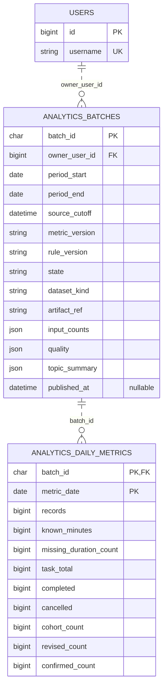

批次头保存快照/job来源、规则与质量，日行经batch外键继承归属；空completed批次允许0日行。复合唯一身份为 `(owner_user_id, artifact_ref, metric_version, rule_version)`，日行按 `(batch_id, metric_date)` 唯一。只有短事务成功后state=completed的结果可读。

主要模型：[backend/app/models/analytics.py](backend/app/models/analytics.py)；发布规则：[S05说明](开发相关文档/阶段报告/AI大数据改造/V2/S05-发布与接口契约.md)。

## 验证与进展

### 本轮 GitHub 提交前复核（2026-10-20）

| 当前检查 | 结果/口径 |
| --- | --- |
| 后端 `unittest discover` | **296项通过**，使用已有backend/.venv；Fake仅用于工程测试 |
| 前端 `pnpm build` | 类型检查与生产构建通过；保留Analytics既有572.35 kB分包提示 |
| 工作流结果交互 | **17项Mock浏览器回归通过**，覆盖运行/节点隔离、刷新记忆、键盘、空态、零/缺失、转义及窄屏 |
| 真实Spark与发布 | 引用S04真实运行及S05真实MySQL/API/双连接证据；提交前不重复写库或运行模型 |

完整本轮命令、渲染与推送状态见 [本次交付报告](开发相关文档/阶段报告/20261020-GitHub同步与README进度更新报告.md)。

### V2 主线进度

| 阶段 | 状态与成果 | 证据 |
| --- | --- | --- |
| S00 现状与数据基线 | 已完成：选择已有业务主线，明确来源与缺口 | [报告](开发相关文档/阶段报告/AI大数据改造/V2/S00-完成报告.md) |
| S01 数据/指标/评价契约 | 已完成：V2-S01-r2、A/B分段设计获批、冻结答案及评分方法 | [契约](开发相关文档/开发规划/AI实践与大数据实施契约.md) |
| S02 现有业务最小闭环 | 已完成：隔离真实API的V1退回/V2通过与关联学习记录 | [报告](开发相关文档/阶段报告/AI大数据改造/V2/S02-完成报告.md) |
| S03 一致性快照与样本 | 已完成：固定ODS、A/B修改删除、独立答案、1万档 | [报告](开发相关文档/阶段报告/AI大数据改造/V2/S03-完成报告.md) |
| S04 PySpark指标与专题 | 已完成：真实Spark、DWD/ADS、质量对账、独立基线与故障恢复 | [报告](开发相关文档/阶段报告/AI大数据改造/V2/S04-完成报告.md) |
| S05 批次发布与只读API | 已完成：正式主/边界批次、本人权限、重放并发与失败恢复 | [报告](开发相关文档/阶段报告/AI大数据改造/V2/S05-完成报告.md) |
| S06 页面与分析验收 | 待执行：同批图表、解释、初步规模复验与浏览器证据 | [交接输入](开发相关文档/阶段报告/AI大数据改造/V2/S05-S06交接索引.json) |
| S07–S10 最小AI联合主线 | 待执行：固定CSV模板、会话/尝试、反馈与事件分析、建议一次应用 | [V2总纲](开发相关文档/AI提示词/20261018-AI实践与大数据分阶段执行包/00-执行总纲与使用顺序.docx) |
| S11 / S12–S13 | S11默认选做；S12–S13保留实验复验与论文/答辩时间 | [阶段提示词](开发相关文档/AI提示词/README.md) |

### 历史业务整改验收（2026-10-16）

2026-10-16 完成 CR1–CR9 严格审查整改，覆盖工作流并发、Context、账号隔离、请求竞态、学习计划、可信来源、校园身份与教学分页。

| 已完成的验证 | 结果 |
| --- | --- |
| 当时后端 `unittest` | **271项通过**，历史记录，不是本轮数量 |
| 前端类型检查与生产构建 | 通过；保留 Analytics 分包体积提示 |
| 隔离 MySQL 主线与专项并发/事务验收 | 通过，测试数据清理后为0行 |
| 真实 API 浏览器主线 | **150次 API 请求，0个页面脚本错误** |

可复核的命令、日志与验收矩阵见 [CR9最终验收报告](开发相关文档/阶段报告/20261016-CR9-严格审查整改最终验收报告.md)；最近一次提交前复查见 [GitHub检查与推送报告](开发相关文档/阶段报告/20261016-GitHub检查与推送报告.md)。以上为本地技术验收记录。

常用检查命令：

```powershell
# 项目根目录：后端测试
cd backend
# Windows未安装IANA数据时，可仅为当前进程使用已存在的WSL时区目录：
# $env:PYTHONTZPATH = '\\wsl.localhost\Ubuntu-24.04\usr\share\zoneinfo'
.\.venv\Scripts\python.exe -B -m unittest discover -s tests -q

# 前端类型与构建
cd ..\frontend
pnpm typecheck
pnpm build
```

### 后续方向

- **AI 质量与成本**：统一额度、预算、并发与质量评测，见 [P22检查点](开发相关文档/阶段报告/20260911-P22-现状检查与实施待确认.md)。
- **上线与真实教学试点**：生产配置、备份恢复、隐私流程及真实师生课程周期验证，见 [P23检查点](开发相关文档/阶段报告/20260911-P23-现状检查与实施待确认.md) 与 [P24试点方案](开发相关文档/AI提示词/P24_真实班级试点.md)。
- **当前下一步 S06**：消费S05完成批次，接入个人离线图表并验证专题解释及初步实验；不改实时统计、不依赖新的AI会话。
- **随后 S07–S10**：落实[确认版实施契约](开发相关文档/开发规划/AI实践与大数据实施契约.md)的最小AI实践；[较早工作流方案](开发相关文档/开发规划/20261014-AI引导式工作流改进方案与验收目标.md)仅作背景，不按旧编号重复建设。

当前适合本地演示与继续开发。AI 评审为静态建议，平台不执行学生代码；统一生产保障和真实班级试点仍待完成。

## 文档导航

| 想了解什么 | 从这里开始 |
| --- | --- |
| 项目定位与业务范围 | [项目说明](开发相关文档/AI辅助校园学习与代码实践平台_项目说明文档.md) |
| 开发资料与过程记录 | [文档索引](开发相关文档/README.md)、[操作日志](开发相关文档/开发日志/开发操作日志.md) |
| 功能交付与验证证据 | [阶段报告](开发相关文档/阶段报告/)、[测试证据](开发相关文档/测试证据/) |
| AI 辅助开发的阶段设计 | [AI提示词索引](开发相关文档/AI提示词/README.md) |
| 大数据源码与复跑 | [analytics入口](analytics/README.md)、[Spark作业](analytics/S04.md)、[发布与API](开发相关文档/阶段报告/AI大数据改造/V2/S05-发布与接口契约.md) |
| 当前毕设范围与进度 | [V2确认契约](开发相关文档/开发规划/AI实践与大数据实施契约.md)、[最新进度](开发相关文档/知识网络/19-开发进度与后续路线.md) |
| 学习材料与源码导览 | [学习材料](开发相关文档/学习材料/)、[知识地图](开发相关文档/知识网络/00-ScholarHub知识地图.md) |
| 演示与答辩 | [原型逐页演示指南](开发相关文档/答辩材料/ScholarHub原型逐页演示指南.md) |

```text
ScholarHub/
├── frontend/           Vue 界面、API、Store 与工作流画布
├── backend/            FastAPI、数据模型、Agent 与执行引擎
├── analytics/          一致性快照、样本、PySpark清洗、Spark SQL与独立核对
├── assets/readme/      仓库首页封面与当前页面截图
├── 开发相关文档/       规划、学习材料、日志、验收与答辩资料
└── README.md           项目入口
```
