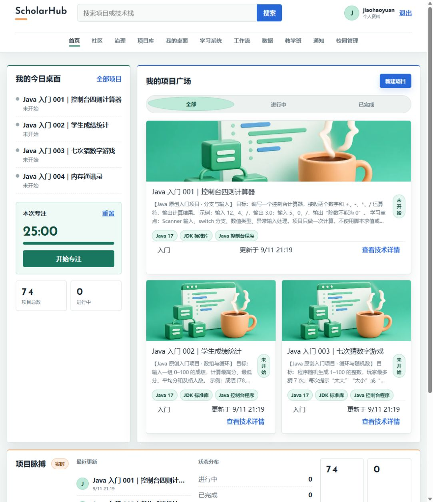
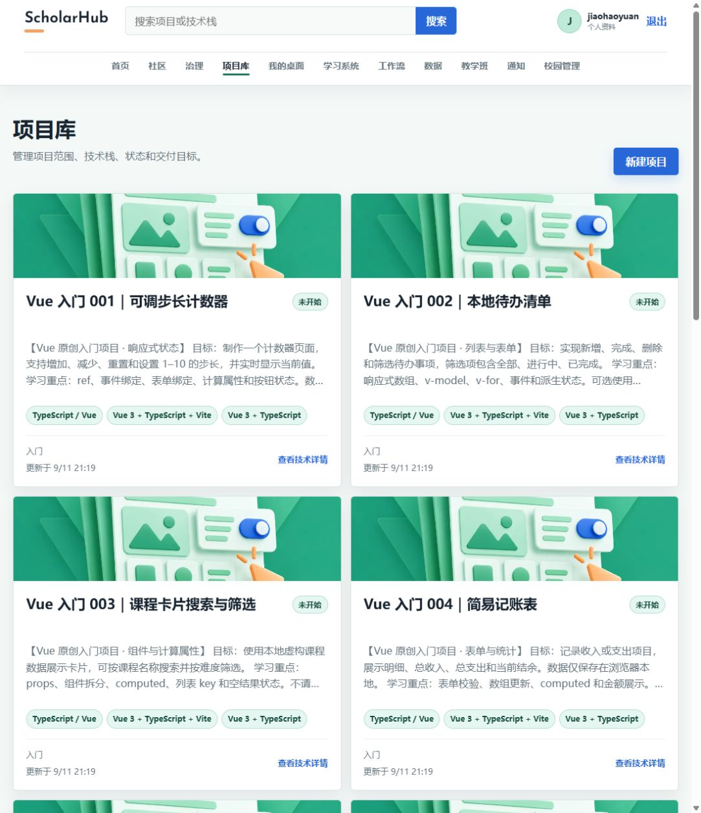
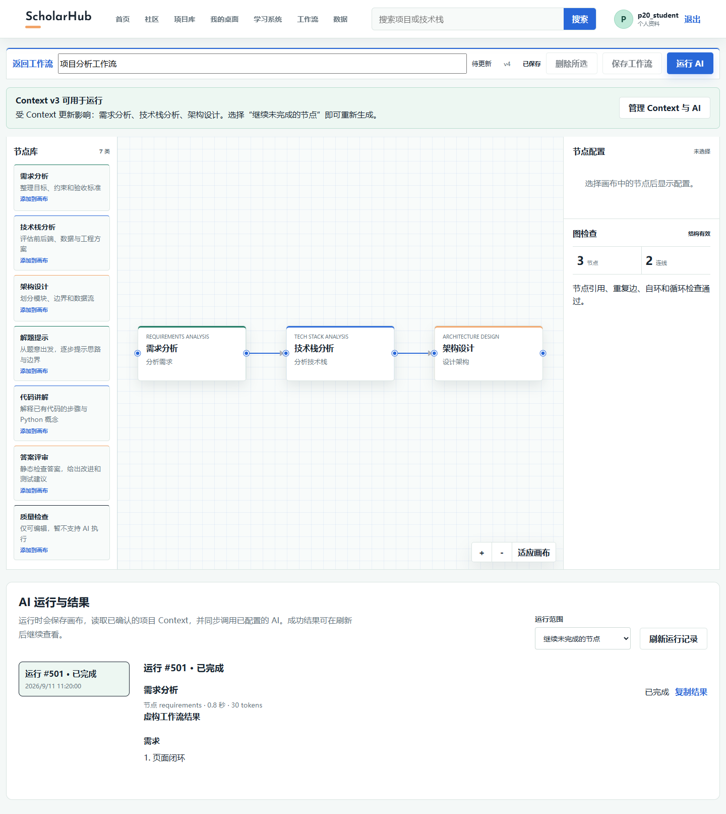
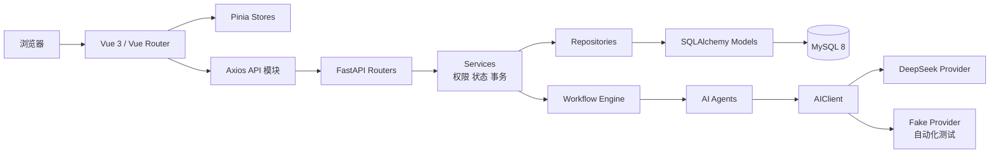
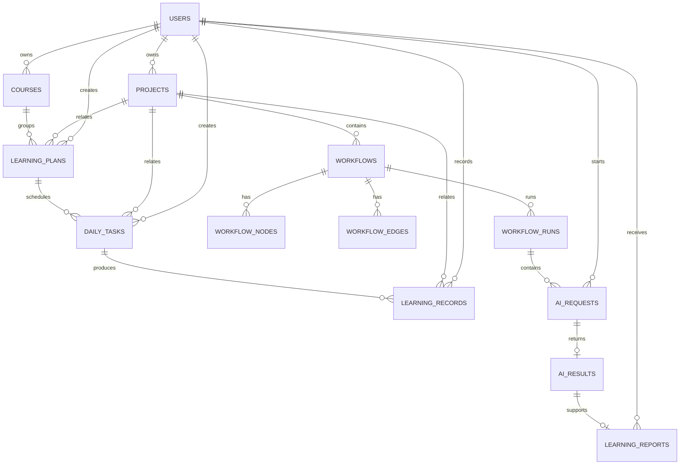
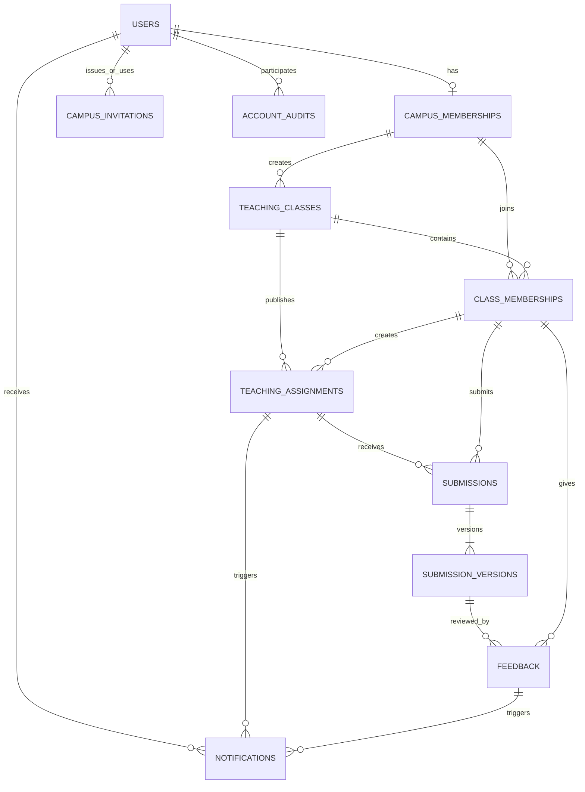
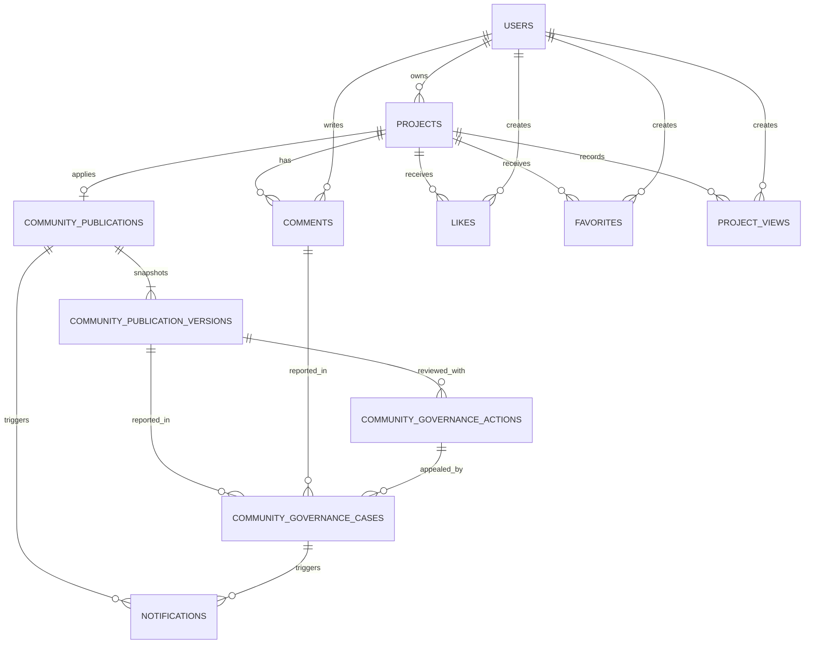

# ScholarHub

**AI 辅助校园学习与代码实践平台**

ScholarHub 面向高校学生，把个人项目、编程练习、学习计划、校园作品社区、可视化 AI 工作流和教学班任务放在同一个系统中。项目采用 Vue 3 + FastAPI + MySQL，已经完成从普通账号、个人学习到“教师发布任务—学生分版本提交—教师反馈—学生修改”的技术闭环。

> 当前状态（2026-09-25）：P00-P21 已完成工程交付；P22 AI 质量与成本控制、P23 上线保障与隐私只完成设计和现状检查；P24 真实班级试点未开始。项目可用于本地演示和继续开发，尚未达到校园生产试点准入条件。

## 项目概览

| 指标 | 当前代码事实 |
| --- | ---: |
| 前端页面组件 | 30 个 `views` |
| 后端 API | 96 个 OpenAPI 路径、136 个操作 |
| 数据库 | 34 张表、81 个外键 |
| 自动化测试 | 203 项后端 `unittest` |
| AI 工作流节点 | 6 类可运行节点 |
| 本地开发库项目 | 74 个（数据库数据，不随 Git 克隆） |

核心能力：

- 账号注册、滑块验证、JWT 登录、改密、会话撤销和管理员受控初始化。
- 个人 Project、Course、LearningPlan、DailyTask、LearningRecord 的独立管理。
- 校园作品发布申请、人工审核、举报、下架、复核、评论、点赞和收藏。
- Vue Flow 工作流编辑、ProjectContext、DeepSeek/Fake Provider、结构化 Agent 结果和失败续跑。
- ECharts 数据统计与 AI 学习报告。
- 学生、教师、管理员固定校园角色；教学班、成员、任务、提交版本、反馈和站内通知。

## 页面预览

### 首页与项目入口



### 分类项目库



### AI 工作流结果



更多页面截图和前后对比见 [前端设计审查报告](开发相关文档/阶段报告/20260912-前端设计审查与最小修改方案.md) 与 [测试证据目录](开发相关文档/测试证据/)。

## 当前开发进度

| 阶段 | 状态 | 已交付内容 | 主要证据 |
| --- | --- | --- | --- |
| P00-P02 | 已完成 | 工程初始化、MySQL Schema、FastAPI 分层、统一错误和日志 | [阶段报告](开发相关文档/阶段报告/20260830-091045-P02-FastAPI后端架构报告.md) |
| P03-P05 | 已完成 | JWT 认证、项目 CRUD、Vue 前端框架和真实 API 联调 | [P05 报告](开发相关文档/阶段报告/20260901-122609-P05-前端基础框架报告.md) |
| P06-P08 | 已完成 | 校园社区、个人工作台、课程/计划/任务/学习记录 | [P08 报告](开发相关文档/阶段报告/20260901-223517-P08-学习系统报告.md) |
| P09-P13 | 已完成 | 工作流编辑器、ProjectContext、Provider、Agent、执行引擎 | [P13 报告](开发相关文档/阶段报告/20260902-194206-P13-工作流执行引擎报告.md) |
| P14-P15 | 已完成 | 真实数据统计、AI 学习报告、系统联调和演示路线 | [P15 报告](开发相关文档/阶段报告/20260904-134029-P15-全系统联调交付报告.md) |
| P16 | 设计已确认 | 校园试点角色、权限、教学实体、隐私与迁移边界 | [P16 报告](开发相关文档/阶段报告/20260905-P16-校园试点设计草案报告.md) |
| P17 | 已完成 | 校园身份、邀请、账号启停、密码重置、审计 | [P17 报告](开发相关文档/阶段报告/20260905-P17-校园身份与账号管理验收.md) |
| P18 | 已完成 | 教学班、成员和教学任务 | [P18 报告](开发相关文档/阶段报告/20260907-P18-班级与教学任务验收.md) |
| P19 | 已完成 | 成果提交、不可变版本、教师反馈和站内通知 | [P19 报告](开发相关文档/阶段报告/20260909-P19-成果提交与教师反馈验收.md) |
| P20 | 已完成 | Project AI 工作台、Context 冲突处理、Workflow 运行记录和结果展示 | [P20 报告](开发相关文档/阶段报告/20260911-P20-AI功能页面闭环验收.md) |
| P21 | 已完成 | 作品审核、举报、下架、复核和社区治理审计 | [P21 报告](开发相关文档/阶段报告/20260911-P21-校园社区治理验收.md) |
| P22 | 仅设计 | 统一额度、平台预算、并发控制、用量结算和质量评测待实施 | [P22 检查点](开发相关文档/阶段报告/20260911-P22-现状检查与实施待确认.md) |
| P23 | 仅设计 | 生产配置、HTTPS、备份恢复、监控、隐私请求和压测待实施 | [P23 检查点](开发相关文档/阶段报告/20260911-P23-现状检查与实施待确认.md) |
| P24 | 未开始 | 真实教师、真实学生和真实课程周期试点 | [阶段提示词](开发相关文档/AI提示词/P24_真实班级试点.md) |

技术完成、教师确认、校方批准和真实课堂效果是四类不同结论。当前仓库只证明工程实现与技术检查，不代表学校已经批准上线。

## 技术栈

### 前端

| 技术 | 版本 | 用途 |
| --- | --- | --- |
| Vue | `^3.5.42` | 组合式 API 和单页应用 |
| TypeScript | `^5.9.3` | 视图、Store 和 API 类型 |
| Vite | `^8.2.2` | 开发服务器和生产构建 |
| Vue Router | `^5.3.0` | 路由和登录/角色守卫 |
| Pinia | `^4.0.3` | 认证与领域状态 |
| Axios | `^1.20.0` | 统一 HTTP 客户端 |
| Element Plus | `^2.14.5` | 表单、反馈和基础组件 |
| Vue Flow | `1.48.2` | 可视化工作流 |
| ECharts | `6.1.0` | 统计图表 |

### 后端与数据

| 技术 | 版本范围 | 用途 |
| --- | --- | --- |
| Python | 3.11+ | 后端和 AI 编排；本次验证使用 3.12.14 |
| FastAPI | `>=0.116,<1.0` | REST API 和 OpenAPI |
| Pydantic | `>=2.11,<3.0` | 请求、响应和模型输出校验 |
| SQLAlchemy | `>=2.0,<3.0` | ORM、事务和查询 |
| MySQL | 8.0+ | 主数据库，UTC 时间 |
| PyMySQL | `>=1.1,<2.0` | MySQL 驱动 |
| HTTPX | `>=0.28,<1.0` | Provider 与接口测试 |
| pwdlib + Argon2 | `>=0.3,<1.0` | 密码哈希 |
| PyJWT | `>=2.10,<3.0` | JWT 签发与校验 |

依赖版本以 [前端 package.json](frontend/package.json)、[pnpm 锁文件](frontend/pnpm-lock.yaml) 和 [后端 requirements.txt](backend/requirements.txt) 为准。

## 系统架构



后端遵循 `Router → Service → Repository → Model → MySQL`。前端页面只通过 `src/api` 调用 FastAPI；角色判断可以改善界面体验，最终授权仍由后端 Service 执行。

## 关键代码地址

### 前端入口

| 位置 | 作用 |
| --- | --- |
| [frontend/src/main.ts](frontend/src/main.ts) | Vue 应用启动入口 |
| [frontend/src/router/index.ts](frontend/src/router/index.ts) | 31 条路由声明、登录守卫和管理员守卫 |
| [frontend/src/api/client.ts](frontend/src/api/client.ts) | Axios、Token 注入和统一错误处理 |
| [frontend/src/stores/](frontend/src/stores/) | Pinia 领域状态 |
| [frontend/src/views/](frontend/src/views/) | 30 个路由页面 |
| [frontend/src/views/ProjectAIWorkspaceView.vue](frontend/src/views/ProjectAIWorkspaceView.vue) | Context、需求分析和 Prompt 页面闭环 |
| [frontend/src/components/WorkflowCanvas.vue](frontend/src/components/WorkflowCanvas.vue) | Vue Flow 画布 |
| [frontend/src/components/WorkflowExecutionPanel.vue](frontend/src/components/WorkflowExecutionPanel.vue) | 运行入口、历史和节点结果 |
| [frontend/src/views/SubmissionDetailView.vue](frontend/src/views/SubmissionDetailView.vue) | 提交版本与教师反馈 |
| [frontend/src/views/CommunityGovernanceView.vue](frontend/src/views/CommunityGovernanceView.vue) | 作者进度与管理员治理入口 |
| [frontend/src/styles/main.css](frontend/src/styles/main.css) | 全局布局、响应式与设计令牌 |

### 后端入口

| 位置 | 作用 |
| --- | --- |
| [backend/app/main.py](backend/app/main.py) | FastAPI 应用、中间件和异常处理 |
| [backend/app/api/v1/router.py](backend/app/api/v1/router.py) | v1 API 聚合入口 |
| [backend/app/api/deps.py](backend/app/api/deps.py) | 会话、身份和服务依赖组装 |
| [backend/app/api/v1/](backend/app/api/v1/) | 17 个业务 Router 模块 |
| [backend/app/services/](backend/app/services/) | 权限、状态机和事务边界 |
| [backend/app/repositories/](backend/app/repositories/) | 受作用域约束的数据访问 |
| [backend/app/models/](backend/app/models/) | 34 张表的 SQLAlchemy Models |
| [backend/app/schemas/](backend/app/schemas/) | 独立 Pydantic 请求/响应模型 |
| [backend/app/ai/client.py](backend/app/ai/client.py) | 统一 AIClient、超时与有界重试 |
| [backend/app/ai/deepseek.py](backend/app/ai/deepseek.py) | DeepSeek Provider 适配 |
| [backend/app/agents/](backend/app/agents/) | 项目分析、Prompt、评审和学习报告 Agent |
| [backend/app/workflow/engine.py](backend/app/workflow/engine.py) | DAG 执行、预算和失败续跑 |
| [backend/app/workflow/registry.py](backend/app/workflow/registry.py) | 可执行节点注册表 |
| [backend/app/cli/init_campus_admin.py](backend/app/cli/init_campus_admin.py) | 首管理员受控初始化 |

### 数据库与验证

| 位置 | 作用 |
| --- | --- |
| [backend/schema.sql](backend/schema.sql) | 新环境完整建库基线 |
| [backend/migrations/](backend/migrations/) | P14、P17、P18、P19、P21 增量迁移 |
| [backend/tests/](backend/tests/) | 21 个测试模块、203 项测试 |
| [backend/scripts/verify_database_schema.py](backend/scripts/verify_database_schema.py) | 实际 MySQL、Models 和 Schema 对比 |
| [backend/scripts/verify_p21_governance.py](backend/scripts/verify_p21_governance.py) | P21 真实 MySQL 隔离验收 |

## 数据模型与 ER 图

完整定义以 [SQLAlchemy Models](backend/app/models/) 与 [schema.sql](backend/schema.sql) 为准。ProjectContext 当前作为 `projects` 的版本化 JSON 字段保存，因此没有单独的 `project_contexts` 表。

### 个人学习与 AI



### 校园身份、教学任务与提交



### 校园社区治理



关键边界：个人 `Course`、`DailyTask`、`Project` 与教学班数据分开；教师权限来自有效 `CampusMembership + ClassMembership`，不是姓名字符串；管理员管理账号、班级元数据和公开内容，不默认读取私人 Context、学习笔记、AI 输入或教学提交正文。

## API 模块

所有接口使用 `/api/v1` 前缀，Swagger 在开发环境默认位于 `http://127.0.0.1:8000/docs`。

| 前缀 | 功能 | Router |
| --- | --- | --- |
| `/auth`、`/users` | 注册、登录、滑块、改密、会话和当前用户 | [auth.py](backend/app/api/v1/auth.py)、[users.py](backend/app/api/v1/users.py) |
| `/projects` | 个人项目、Context 和社区互动入口 | [projects.py](backend/app/api/v1/projects.py)、[project_context.py](backend/app/api/v1/project_context.py) |
| `/community` | 公开快照、发布审核、举报和复核 | [community.py](backend/app/api/v1/community.py) |
| `/workspace`、`/learning` | 工作台、课程、计划、任务和学习记录 | [workspace.py](backend/app/api/v1/workspace.py)、[learning.py](backend/app/api/v1/learning.py) |
| `/workflows`、`/agents`、`/ai` | 图编辑、执行、结果、Agent 和 Provider | [workflows.py](backend/app/api/v1/workflows.py)、[agents.py](backend/app/api/v1/agents.py) |
| `/statistics`、`/learning-reports` | 数据统计和 AI 学习报告 | [statistics.py](backend/app/api/v1/statistics.py)、[learning_reports.py](backend/app/api/v1/learning_reports.py) |
| `/campus` | 校园身份、班级、任务、提交、反馈和通知 | [campus.py](backend/app/api/v1/campus.py)、[teaching.py](backend/app/api/v1/teaching.py)、[submissions.py](backend/app/api/v1/submissions.py) |

## 本地启动

### 环境要求

- Node.js 22+
- pnpm 11+
- Python 3.11+
- MySQL 8.0+

### 1. 初始化后端

```powershell
cd backend
python -m venv .venv
.\.venv\Scripts\Activate.ps1
python -m pip install -r requirements.txt
Copy-Item .env.example .env
```

编辑 `backend/.env`，至少配置 `DATABASE_URL` 和长度不小于 32 的 `JWT_SECRET`。需要调用真实 DeepSeek 时再配置 `DEEPSEEK_API_KEY`；自动化测试默认使用 Fake Provider，不消耗模型额度。

新数据库在确认没有 ScholarHub 业务表后执行：

```powershell
mysql --user=root --password --execute="source schema.sql"
```

已有数据库必须备份后按时间顺序审查并执行 [增量迁移](backend/migrations/)，不要用 `schema.sql` 覆盖升级。

启动后端：

```powershell
python -m uvicorn app.main:app --reload --host 127.0.0.1 --port 8000
```

### 2. 初始化前端

```powershell
cd frontend
pnpm install
Copy-Item .env.example .env
pnpm dev
```

- 前端：`http://127.0.0.1:5173`
- Swagger：`http://127.0.0.1:8000/docs`
- 健康检查：`http://127.0.0.1:8000/api/v1/health`

### 3. 校园管理员

系统没有默认管理员密码。负责人核验一个现有账号后，在 `backend` 目录执行：

```powershell
python -m app.cli.init_campus_admin --user-id <用户编号> --reason "已核验的初始化原因"
```

后续教师和学生由管理员签发定向邀请。详细边界见 [backend/README.md](backend/README.md#p17-校园身份初始化)。

## 验证命令

```powershell
# 后端
cd backend
.\.venv\Scripts\Activate.ps1
python -m unittest discover -s tests -v
python -m pip check
python -m scripts.check_database
python -m scripts.verify_database_schema
python -m scripts.verify_p21_governance

# 前端
cd ..\frontend
pnpm typecheck
pnpm build
pnpm audit --prod --audit-level high
```

2026-09-25 的本次结果：203 项后端测试通过；数据库连接通过；34 张表、81 个外键与 Models 一致；P21 隔离验收通过；前端类型检查、生产构建和生产依赖审计通过。构建保留 `AnalyticsView` 约 572 kB 的分块警告。旧 `scripts.verify_integration` 仍按 P15 公共社区规则运行，P21 后会在社区入口得到 403，当前不能作为全量发布门槛。

项目没有配置前端 Lint、Ruff、Mypy、Bandit、pip-audit 或 CI 工作流，因此这些检查不能标记为通过。

## 本地开发数据说明

本次只读核对的本地数据库有 2 个用户、1 个校园成员、74 个项目、3 个工作流、7 次工作流运行、23 条 AIRequest、2 份学习报告和 2 个社区发布记录；教学班、教学任务、提交和反馈均为 0。74 个项目由 6 个开源学习案例、50 道 Python 入门练习和 18 个 Java/C/Vue 入门项目组成。

这些是本机数据库内容。Git 仓库只保存代码、迁移和 [学习材料](开发相关文档/学习材料/)，不会上传账号、密码、API Key、邀请凭证或业务数据库；克隆仓库后不会自动得到这 74 个项目。

## 当前限制与上线门槛

- P22 尚未实施：各 AI 入口没有统一的用户日额度、平台总预算、统一并发预留/核销和质量评测闭环。
- P23 尚未实施：没有生产环境模板、HTTPS/Nginx 验收、最小权限数据库账号、备份恢复演练、监控告警、隐私导出/删除流程和有界压测证据。
- 当前滑块、限流和部分运行状态依赖单进程内存；未解决共享状态前只能按单 worker 试点设计评估。
- AI 与 Workflow 为同步调用；浏览器断线不等于服务端调用取消，进程内任务也不是持久化队列。
- 当前没有在线 IDE、代码上传执行、自动判题、WebSocket、私信、关注、复杂推荐、多学校租户或统一身份认证。
- 真实教师教学评审、校方数据政策确认、费用批准和真实班级试点均未发生。

因此，当前结论是“本地原型和工程闭环可演示”，不是“可以直接公开部署”。完整现状见 [项目全量现状与 GitHub 交付报告](开发相关文档/阶段报告/20260925-项目全量现状与GitHub交付报告.md)。

## 文档入口

- [项目说明](开发相关文档/AI辅助校园学习与代码实践平台_项目说明文档.md)
- [开发文档索引](开发相关文档/README.md)
- [AI 阶段提示词](开发相关文档/AI提示词/README.md)
- [知识地图](开发相关文档/知识网络/00-ScholarHub知识地图.md)
- [原型逐页演示指南](开发相关文档/答辩材料/ScholarHub原型逐页演示指南.md)
- [开发操作日志](开发相关文档/开发日志/开发操作日志.md)
- [阶段报告目录](开发相关文档/阶段报告/)

## 项目结构

```text
ScholarHub/
├── frontend/           Vue 3 前端
├── backend/            FastAPI、SQLAlchemy、MySQL 与 AI/Workflow
├── 开发相关文档/       规划、说明、日志、报告、证据和答辩材料
├── README.md           GitHub 项目入口
└── PRODUCT.md          前端产品设计约束
```
