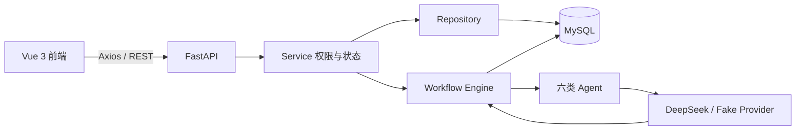

# ScholarHub：AI 辅助校园学习与代码实践平台项目说明

- 更新时间：2026-09-25
- 当前代码版本：P21 技术交付完成；P22/P23 为设计检查点，P24 未开始
- 项目性质：大数据专业毕业设计、本地开发与校园试点准备版本

## 1. 项目定位

ScholarHub 面向高校学生的项目实践与学习积累，将个人项目、校园代码社区、学习计划、可视化 AI 工作流、数据统计和教学班任务放在同一个平台中。

平台强调“AI 辅助学习”，主要帮助学生理解题目、分析项目、拆解任务、讲解代码、评审答案和复盘学习数据。系统不会自动执行学生代码，也不把 AI 生成结果当作测试通过、教师评价或学习完成证明。

当前阶段记录覆盖 P00-P23：P00-P15 完成原系统功能，P16 完成校园试点需求与数据设计，P17-P19 完成身份、教学班和成果反馈，P20 完成 AI 用户页面闭环，P21 完成校园社区人工治理。P22 与 P23 只有实施方案和现状检查，尚未进入业务开发；P24 真实班级试点未开始。

## 2. 当前完成情况

| 范围 | 当前状态 | 已有结果 |
| --- | --- | --- |
| P00-P02 工程基础 | 已完成 | Vue/FastAPI/MySQL 工程、统一配置、异常处理、日志和基础数据库结构 |
| P03-P05 账号与项目 | 已完成 | 注册、登录、滑块验证、个人项目 CRUD、项目详情和统一前端布局 |
| P06-P08 社区与学习 | 已完成 | 项目发布、浏览、点赞、收藏、评论、个人工作台、课程、计划、每日任务和学习记录 |
| P09-P13 AI 工作流 | 已完成 | Vue Flow 图编辑、ProjectContext、DeepSeek Provider、核心 Agent、DAG 执行、状态恢复和结果持久化 |
| P14-P15 数据与联调 | 已完成 | ECharts 统计、AI 学习报告、Fake/真实 Provider 联调和答辩路径 |
| 内容补齐 | 已完成首批 | 本地开发库录入 6 个开源学习案例和 50 道原创 Python 入门练习 |
| 工作流教学能力 | 已完成 | 工作流运行入口、历史结果、失败续跑，以及解题提示、代码讲解、答案评审三个教学节点 |
| P16 校园试点设计 | 设计草案已完成并确认到 D6 | 固定角色、权限矩阵、教学实体、隐私边界、迁移策略和 P17-P24 依赖 |
| P17 校园身份 | 已完成 | 学生/教师/管理员固定角色、定向邀请、资格兑换、账号启停、改密、会话撤销、密码重置和审计 |
| P18 班级任务 | 已完成 | 教学班、班级成员、任务草稿/发布/关闭/归档、教师与学生作用域隔离 |
| P19 成果提交与反馈 | 已完成 | 不可覆盖提交版本、教师退回/通过、修改后重交、本人历史、待处理列表和站内通知 |
| P20 AI 页面闭环 | 已完成 | Project Context、需求分析、开发 Prompt、Workflow 运行记录、失败续跑和结果展示 |
| P21 社区治理 | 已完成 | 发布申请、不可变公开快照、人工审核、举报、下架、复核和通知 |
| P22 AI 质量与成本 | 仅设计 | 统一额度、平台预算、并发预留/核销和质量评测待实施 |
| P23 上线保障与隐私 | 仅设计 | 生产配置、备份恢复、监控、压测和隐私请求待实施 |
| P24 真实班级试点 | 未开始 | 尚无真实教师、学生、课程周期或校方批准记录 |

这里的“已完成”表示代码、迁移和对应技术验收已经完成，不等于学校已经批准上线，也不等于真实教师和学生已经使用。

## 3. 已经实现的主要功能

### 3.1 账号认证与安全

- 普通用户注册、登录、退出和当前用户查询。
- 登录前滑块验证；短期凭证只能使用一次。
- 密码使用 Argon2id 哈希保存，JWT 携带账号版本而不保存校园角色。
- 改密、账号启停、校园角色或资格变化后，旧会话立即失效。
- 认证和敏感操作具有有界的进程内限流。
- 接口错误统一返回安全错误码、消息和请求编号，不泄露 SQL、堆栈或密钥。

### 3.2 个人项目与校园代码社区

- 用户可创建、查看、修改和删除自己的 Project。
- 项目支持技术栈、难度、需求清单、进度、状态和社区发布状态。
- 社区支持项目列表、详情、浏览、点赞、收藏、评论和标签筛选。
- 发布采用申请、不可变快照和人工审核；举报、下架、恢复与复核均记录理由和治理动作。
- 发布只开放明确的社区字段，其他用户不能修改原项目或读取 ProjectContext 等私人数据。
- 项目卡片和详情文字已经做层级、字号、间距与长内容适配。

### 3.3 个人学习系统

- 个人工作台汇总任务、学习记录和项目进度。
- Course、LearningPlan、DailyTask、LearningRecord 均按当前用户隔离。
- 支持课程、学习计划、每日任务和学习记录的增删改查，以及任务完成操作。
- 个人课程和任务不会因为加入教学班而自动公开、复制或改写。

### 3.4 可视化 AI 工作流

- 使用 Vue Flow 创建、拖动、连接、配置和保存工作流节点。
- 后端校验节点、重复边、自环、跨图连线和 DAG 循环。
- ProjectContext 在项目 JSON 字段中保存，并使用版本控制和过期状态传播。
- 前端支持“运行 AI”“保存并运行 AI”、失败续跑、全部重跑、运行历史和结构化结果展示。
- 当前注册六类可运行节点：
  - `requirements_analysis`：需求分析。
  - `tech_stack_analysis`：技术栈分析。
  - `architecture_design`：架构设计。
  - `exercise_hint`：分层解题提示。
  - `code_explanation`：代码讲解。
  - `answer_review`：答案静态评审。
- 节点结果保存到 AIRequest、AIResult 和 WorkflowRun；修改关键配置后，受影响的旧结果会标记为待更新。

### 3.5 数据统计与 AI 学习报告

- ECharts 展示 7 日/30 日趋势、项目状态、技术栈和社区统计。
- 后端从真实数据库聚合数据，不使用页面假统计。
- 当前用户可生成并查询结构化 AI 学习报告。
- 学习报告与教师反馈、项目完成、任务完成和学习时长是不同状态，不能互相伪造。

### 3.6 校园身份与账号管理

- 普通账号与 CampusMembership 分离；一个账号当前只能具有学生、教师、管理员中的一种固定校园角色。
- 系统不提供默认管理员密码，也不会自动提升首个注册用户。
- 首管理员只能由负责人核验现有账号后，通过受控维护命令初始化。
- 管理员可向指定账号或核验邮箱签发最长 72 小时的一次性学生/教师邀请。
- 已有账号在 `/campus/join` 兑换邀请；新用户可以携带邀请凭证注册并原子获得资格。
- 管理员可管理账号启停、资格状态、角色、一次性密码重置和审计记录。
- 最后一个有效管理员不能被停用、撤销或降级。
- 管理员默认无权读取私人项目、学习笔记、Context、AI 输入或教学任务正文。

### 3.7 教学班与教学任务

- 有效教师可创建教学班，并自动成为该班首位教师成员。
- 教师只能管理本人获授权的班级；跨班级 ID 访问会被拒绝。
- 管理员可以查看班级元数据、安排成员和归档班级，但不能读取任务正文。
- 学生只能查看自己已加入的班级以及非草稿任务。
- 班级成员唯一，支持教师/管理员移除和学生本人退出。
- 教学任务支持 `draft → published → closed → archived` 状态流转。
- 发布后冻结标题、说明、学习目标和交付要求，只允许延长截止时间。
- 项目模板仅保存教师本人 Project 的白名单快照，不复制 Context、私人笔记、AI 报告或仓库地址。

### 3.8 成果提交、教师反馈与通知

- 学生可提交文字说明、HTTPS 仓库链接、代码版本标识，并可关联本人 Project 的标题快照。
- 提交按版本追加，旧正文和反馈不会被新版本覆盖；相同请求重试不会重复生成版本。
- 本班有效教师可对最新待评版本退回修改或确认通过，反馈固定到对应版本。
- 教师确认通过会生成一条无学习时长的系统学习事件，不改变个人 Project、DailyTask 或课程状态。
- 任务发布与教师反馈会生成接收人专属站内通知；通知不复制提交正文。
- 教师响应不返回私人 Project ID、描述、Context、笔记或 AI 输入，管理员也没有提交正文读取权限。

## 4. 当前本地数据状态

截至 2026-09-25，本地开发数据库的只读聚合状态为：

| 数据 | 数量 | 说明 |
| --- | ---: | --- |
| 普通用户 | 2 | 已有本地开发账号；不在文档记录凭据 |
| Project | 74 | 6 个开源学习案例、50 道 Python 练习和 18 个 Java/C/Vue 入门项目 |
| 有效校园管理员 | 1 | 已按用户授权完成首管理员初始化 |
| 有效教师 | 0 | 尚未创建或邀请真实教师 |
| 有效学生 | 0 | 尚未创建或邀请真实学生 |
| 教学班 | 0 | P18 功能已实现，但尚未创建真实班级 |
| 教学任务 | 0 | 尚未布置真实教学任务 |
| 成果/版本/反馈 | 0 | P19 结构和功能已实现；当前没有真实班级成果 |
| 通知 | 2 | 本地业务记录，不随 Git 仓库分发 |
| 社区发布记录 | 2 | 已进入 P21 治理模型；不代表校方公开批准 |

Git 仓库只保存代码、迁移和学习材料，不保存上述数据库业务数据、账号密码、API Key 或邀请凭证。其他环境拉取代码后不会自动得到这 74 个项目或本地管理员账号。

## 5. 尚未实现或尚未完成的内容

### 5.1 P22-P24 校园试点路线

| 阶段 | 尚未完成的内容 | 开始条件 |
| --- | --- | --- |
| P22 AI 质量与成本 | 平台预算、个人额度、并发限制、失败计量和教师质量评审 | 先确认费用承担者和额度 |
| P23 上线与隐私 | HTTPS、备份恢复、数据导出删除、留存策略、部署和运维说明 | 先确认服务器、域名、维护者和校方数据政策 |
| P24 真实班级试点 | 真实教师、真实学生、课程周期、使用记录和退出复盘 | P22-P23 完成并取得教师与校方批准 |

### 5.2 其他没有实现的能力

- 没有在线 IDE、代码上传执行、自动判题或任意 shell 运行能力。
- 没有课程表文件上传、语音输入或 AI 自动创建每日任务。
- 没有私信、关注、好友、即时聊天或复杂推荐系统。
- 没有学校统一身份认证、多学校租户或通用权限编排平台。
- 没有 Redis、Celery、分布式任务队列或多 worker 共享滑块状态。
- Provider 架构可以扩展，但当前实际接入 DeepSeek 和测试用 Fake Provider；OpenAI、Claude 等不是已完成接入。
- 没有生产域名、HTTPS、监控告警、正式备份周期或校园生产部署。
- 真实教师确认、学生参与安排、AI 费用批准和校方试点批准均未取得。

## 6. 实际技术栈

### 6.1 前端

| 技术 | 当前版本/范围 | 用途 |
| --- | --- | --- |
| Vue | `^3.5.42` | 单页面应用与组合式 API |
| TypeScript | `^5.9.3` | 前端类型与 API 契约 |
| Vite | `^8.2.2` | 开发服务器和生产构建 |
| Element Plus | `^2.14.5` | 表单、反馈和基础组件 |
| Vue Router | `^5.3.0` | 统一前端路由与登录/校园角色守卫 |
| Pinia | `^4.0.3` | 认证和领域状态管理 |
| Axios | `^1.20.0` | API 请求、Token 注入和 401 处理 |
| Vue Flow | `1.48.2` | 可视化工作流节点与连线 |
| ECharts | `6.1.0` | 学习和平台数据图表 |

### 6.2 后端

| 技术 | 当前版本范围 | 用途 |
| --- | --- | --- |
| Python | 3.11+，本地验证使用 3.12 | 后端与 AI 工作流运行时 |
| FastAPI | `>=0.116,<1.0` | REST API、依赖注入和 OpenAPI |
| Pydantic / Settings | `>=2.11,<3.0` / `>=2.10,<3.0` | 请求响应 Schema 和配置校验 |
| SQLAlchemy | `>=2.0,<3.0` | ORM、事务和数据库查询 |
| PyMySQL | `>=1.1,<2.0` | MySQL 驱动 |
| Uvicorn | `>=0.35,<1.0` | ASGI 开发服务 |
| HTTPX | `>=0.28,<1.0` | AI Provider 和接口测试请求 |
| PyJWT | `>=2.10,<3.0` | JWT 签发与校验 |
| pwdlib[argon2] | `>=0.3,<1.0` | Argon2id 密码哈希 |

后端保持单体分层：

```text
Router → Service → Repository → SQLAlchemy Model → MySQL
```

请求/响应使用独立 Pydantic Schema，Service 处理所有权、状态和权限，Repository 负责查询与持久化。

### 6.3 数据库、AI 与运行方式

- MySQL 8.0+ 是主数据库；当前 Models、`schema.sql` 和实际开发库均为 34 张表、81 个外键。
- 数据库存储 UTC 时间，API 恢复带时区时间，前端按用户环境展示。
- DeepSeek 通过统一 AIClient/Provider 调用，模型、Key、超时、重试和预算均来自后端环境配置。
- Workflow Engine 使用有界 DAG 顺序执行；默认上限为 12 个运行节点、12 回合、90 秒和配置的 Token 预算。
- 当前为单体、单前端、单 MySQL 的本地开发部署，没有微服务和分布式队列。

## 7. 系统架构与数据流



个人学习链路已经形成：

```text
选择项目 → 建立学习计划/任务 → 编辑并运行 AI Workflow
→ 保存学习记录 → 查看统计与 AI 学习报告 → 自愿发布社区
```

校园教学链路已完成到 P19 的技术闭环：

```text
管理员核验身份 → 教师建班 → 加入学生 → 保存任务草稿
→ 发布任务 → 学生查看并提交 V1 → 教师退回并通知
→ 学生提交 V2 → 教师确认通过 → 双方查看历史
```

该链路已通过隔离样本和真实 MySQL 验证，不代表真实教师或学生已经参与课堂试点。

## 8. 核心数据与权限边界

当前主要数据领域包括：

- 账号：User、CampusMembership、CampusInvitation、PasswordReset、AccountAudit。
- 项目社区：Project、Tag、Comment、Like、Favorite、ProjectView。
- 个人学习：Course、LearningPlan、DailyTask、LearningRecord、LearningReport。
- AI 工作流：Workflow、WorkflowNode、WorkflowEdge、WorkflowRun、AIRequest、AIResult。
- 校园教学：TeachingClass、ClassMembership、TeachingAssignment、Submission、SubmissionVersion、Feedback、Notification。

关键权限规则：

- User 是私人 Project、Course、DailyTask、LearningRecord 和 AI 结果的所有者边界。
- 教师姓名字符串不是教师权限；有效 CampusMembership 和 ClassMembership 才构成教学授权。
- 管理员管理账号、资格、班级元数据和公开内容，不自动获得私人学习数据或教学正文权限。
- 学生之间、不同班级教师之间不能凭资源 ID 越权读取。
- 教学班归档优先于硬删除，不能级联删除已有个人学习数据。

## 9. 主要页面入口

| 页面 | 功能 |
| --- | --- |
| `/login`、`/register`、`/profile` | 认证、资料、校园资格和账号安全 |
| `/projects`、`/projects/:id` | 个人项目库与项目详情 |
| `/community` | 校园代码社区 |
| `/workspace/*` | 个人任务、项目和学习记录工作台 |
| `/learning`、`/learning/tasks`、`/learning/records` | 课程、计划、每日任务和学习记录 |
| `/workflows`、`/workflows/:id` | 工作流编辑、运行和结果 |
| `/analytics` | 数据统计与 AI 学习报告 |
| `/campus/join` | 兑换校园邀请 |
| `/campus/admin/accounts` | 校园管理员账号与邀请管理 |
| `/campus/classes` | 教师和学生的教学班入口 |
| `/campus/assignments/:assignmentId` | 教学任务详情 |
| `/campus/submissions`、`/campus/submissions/:submissionId` | 学生提交历史、教师待评列表、版本与反馈详情 |
| `/notifications` | 本人教学通知和已读状态 |

后端当前 OpenAPI 共 96 个路径、136 个操作，Swagger 地址为 `http://127.0.0.1:8000/docs`。

## 10. 当前验证结果与限制

最近一次完整交付验证结果：

- 后端 `unittest`：203 项通过。
- MySQL 结构：34 张表、81 个外键与 Models 一致。
- P19 真实 MySQL 事务链路：V1 退回、V2 通过、同键并发提交/反馈去重和跨班隔离通过，临时数据已清理。
- Python `pip check`：无损坏依赖。
- 前端 `vue-tsc` 和 Vite 生产构建：通过，2376 个模块转换完成。
- `git diff --check`：通过。

当前仍有以下验证限制：

- Ruff、Mypy、Bandit 没有安装，不能写成已经通过。
- Vite 对 AnalyticsView 保留约 571.90 kB 的既有分块警告。
- 外部依赖漏洞服务曾超时，尚无完整安全审计结论。
- 校园角色的 API 与真实 MySQL 隔离已经测试，但尚未由真实教师和学生完成课堂验收。

## 11. 下一步建议

下一开发阶段是 P22“AI 质量与成本控制”。实施前需要确认费用承担者、平台总额度、用户日额度、学校统计时区、真实模型评测次数，以及哪些教学数据允许送往外部模型。

P22 应在现有 AIClient 前建立统一计量边界，不能只约束 Workflow；P23 再处理生产配置、备份恢复、隐私请求和运维责任。真实校园试点必须等到 P22-P23 完成，并由真实教师、维护者和校方分别确认课程、成员、访问方式、数据政策与 AI 费用。

项目当前可以作为“已形成最小教学闭环与 AI 页面闭环的毕业设计开发版本”进行演示，演示时应明确说明：已有功能来自真实代码和数据库验证；P22-P24、生产部署和真实校园使用仍未完成。
