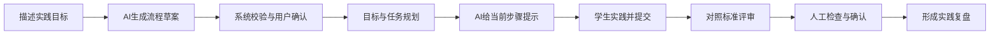

# ScholarHub AI 引导式工作流改进方案与验收目标

日期：2026-10-14。状态：设计提案，尚未实施。

## 1. 确定的目标与建议定位

用户已明确：工作流作为核心创新点，展示 AI 如何分步骤辅助项目实践；目前的问题是画图、连线、执行以后，对实际项目推进帮助不大；希望既有 AI 引导，也能由 AI 生成工作流。

建议把工作流定位为：**用户用自然语言描述实践目标，AI 生成可编辑、可验证的学习流程；执行时根据用户实际提交的代码、结果和问题提供逐步指导，最终留下可追溯的实践成果。**

本方案中的“AI 生成工作流”指生成节点、步骤内容、依赖与输入输出约定。完整项目代码自动生成、代码自动运行和自动判题不纳入首版。用户尚未确定论文题目和导师对大数据技术的硬性要求，不能据此断言专业要求已经满足。

确定的产品目标：

1. 从“我想完成什么”进入，降低配置节点和提示词的门槛。
2. 每个步骤说明当前任务、为什么做、需要什么输入、应提交什么以及怎样检查。
3. 前一步的有效产出成为后一步明确的输入，形成有意义的依赖。
4. 用户有实践、提交、修正与确认的机会，流程能等待用户，而不是一次生成所有建议。
5. 根据具体提交物给出可定位的问题和下一步，避免反复输出泛泛建议。
6. 保留流程版本、实践尝试、AI 反馈与人工验证来源，用于学习复盘和毕业答辩。

首版暂定面向有基础语法知识的高校 Python 学习者。这是为了适配当前已经实现的教学节点；用户群体可在方案确认时调整。

## 2. 现有实现的价值和主要缺口

以下是本次对当前工作区代码的只读检查结论；历史测试记录没有作为本次运行通过的证据。

| 当前事实 | 对用户的影响 | 改进优先级 |
|---|---|---|
| 节点库显示 7 类：需求分析、技术栈分析、架构设计、解题提示、代码讲解、答案评审、质量检查；实际注册了前 6 类 | “质量检查”可以放入画布，但运行时会被阻止，容易造成错误期待 | P1：明确区分可运行节点和规划能力 |
| 已有 DAG 顺序执行、结果结构校验、历史记录、预算、失败续跑和上下文版本控制 | 有可复用的工程基础；当前功能具备工程价值 | 保留并复用 |
| 项目规划三节点主要处理需求、技术选型和架构 | 更适合项目启动阶段；对正在学习一小段代码或已经选定技术的用户，帮助有限 | P1：按实践场景选择步骤 |
| 教学节点没有把提示、评审问题等结果写入共享项目 Context；当前节点输入也没有显式绑定前序教学产出 | 教学节点间的连线主要保证顺序，不能保证后一步针对前一步的具体反馈继续引导 | P0：建立产出引用和输入绑定 |
| 执行前一次性校验各节点输入；讲解和评审节点提前要求填写代码 | “先给提示—学生实践—提交代码—再评审”的自然学习过程难以表达 | P0：持久化等待用户提交的状态 |
| Agent 当前一次调用、输出结构化 JSON，不调用工具；答案评审仅静态阅读 | 能给建议，但不能证明代码运行正确，也不能自动证明用户完成任务 | P0：区分建议、提交和验证来源 |
| 运行结果主要展示、复制，缺少将本次反馈落实为具体行动的入口 | 用户看完结果仍需自己重新规划；工作流与实践成果之间的连接较弱 | P0：提供本步骤实践与问题修正入口 |
| 教学提示和配置文案主要针对 Python | 不宜宣称已经覆盖 Java、C、Vue、PySpark 等全部学习场景 | P1：首版聚焦 Python，扩展时单独验收 |
| 当前执行引擎拒绝条件边，状态枚举没有等待用户状态 | 暂不能把“需要修改”画成循环边后直接交给原引擎执行 | P0：明确新引导模式与旧执行模式的边界 |

代码依据：

- [节点库和可执行类型](../../frontend/src/domain/workflow.ts)：`WORKFLOW_NODE_TEMPLATES`、`EXECUTABLE_NODE_TYPES`。
- [已注册节点](../../backend/app/api/deps.py)：`build_workflow_registry`。
- [节点行为](../../backend/app/workflow/agents.py)、[输入和结果结构](../../backend/app/workflow/schemas.py)。
- [执行引擎](../../backend/app/workflow/engine.py)：`run`、`_build_plan`、`_node_input`、`_context_updates`。
- [Agent 调用边界](../../backend/app/agents/base.py)：`_build_messages`。
- [结果展示](../../frontend/src/components/WorkflowExecutionPanel.vue)、[状态定义](../../backend/app/models/enums.py)。

## 3. 官方资料中值得借鉴的设计

本节说明公开产品的设计模式；后续章节是针对 ScholarHub 的建议，不代表这些产品直接提供了本方案的全部功能。

| 参考 | 官方资料确认的能力 | 本项目可借鉴的设计 |
|---|---|---|
| n8n AI Workflow Builder | 用自然语言创建、调整和调试工作流，包括节点选择与配置；用户可以检查并进一步修改生成结果 | 增加“描述目标—生成草案—审阅修改—确认应用”的入口，降低画图门槛 |
| Dify Workflow 教程 | 输入成为下游可引用变量；结构化抽取、节点输出引用、测试运行和节点调试共同组成流程 | 将前序产出绑定到具体输入，展示真实数据如何流动，提供单步骤检查 |
| LangGraph Interrupts | 保存状态后暂停，收到人的输入后恢复；恢复涉及节点重入和副作用幂等问题 | 把等待实践和确认设为明确状态，恢复时校验版本并防止重复应用成果 |

来源：[n8n 官方 AI Workflow Builder](https://docs.n8n.io/build/ways-of-building-workflows/ai-workflow-builder.md)、[Dify 官方 Workflow 实践教程](https://docs.dify.ai/en/guides/application-orchestrate/creating-an-application)、[LangGraph 官方 Interrupts](https://docs.langchain.com/oss/python/langgraph/interrupts)。

建议借鉴交互与状态设计，继续使用已有 Vue 3、FastAPI、MySQL、Vue Flow、Provider 和 Agent 基础。现阶段没有证据表明必须新增 n8n、Dify 或 LangGraph 依赖。

## 4. 改进后的完整使用流程

### 4.1 先用自然语言生成草案

用户输入示例：

> 我会 Python 基础语法，想做一个 CSV 学习记录分析练习。先学会清洗异常数据，再按日期统计学习分钟。请一步步引导我，我希望自己写代码。

系统从当前项目和用户输入提取：实践目标、已有基础、固定技术、时间或范围限制、已有材料、期望成果。仅在缺少影响流程的重要信息时追问，一轮优先不超过 3 个问题；不重复询问已经确认的信息。

AI 返回结构化草案，每个步骤包含：用途、具体任务、所需输入、预期产出、检查标准、前置步骤以及是否等待用户。画布位置由前端按依赖布局，模型负责流程含义。

生成结果必须经过服务端确定性校验：节点类型在允许范围内；引用存在且来自合法前序步骤；图无环；配置符合节点输入结构；规模和用量有界；需要人工提交的步骤不伪造现成提交物；资料不足时返回待补充信息。白名单以当前阶段已经支持的能力为准；新引导能力尚未实现时，相关设计只能标成不可执行的预览，不能作为可运行图应用。格式校验不能替代教学合理性评价。

草案通过检查后显示在画布和步骤列表中。用户可以说“先去掉架构设计”“把清洗和统计拆开”等，系统显示变更摘要与受影响步骤。修改现有流程时用版本校验，保留用户未批准替换的配置，已经执行的流程不悄悄变成另一张图。

“生成草案”“确认应用”“开始引导”是三个明确动作。生成草案不会自动执行、覆盖现有工作流或改写项目技术栈。

### 4.2 执行时围绕当前一步组织页面

页面建议左侧是步骤进度和已确认成果，中央是当前任务与提交区，右侧按需显示 AI 提示、解释和评审。画布保留，用于查看依赖和高级编辑；普通学习者可以沿步骤推进。

每一步至少回答五个问题：现在做什么、为什么做、需要哪些资料、提交什么、如何检查。提示分层：先提问和给方向；仍有困难时提供更具体的思路；代码讲解由用户需要时触发。首版保持自主实践目标，不默认直接交付完整答案。

AI 输出中的“下一步”要对应当前计划中的实际步骤或明确修正任务。学生提交自己的代码、运行结果或解释后，再进行针对性反馈。提交记录和 AI 结果均保留版本，重试不覆盖用户之前的尝试。

### 4.3 给连线明确的输入输出含义

例如目标拆解产出的 `acceptance_criteria` 被实践规划使用；规划产出的当前任务被提示使用；学生最新一次提交和对应验收标准被评审使用；评审问题与下一次修改关联；复盘只总结实际提交和已有反馈。

采用受控的产出引用，例如“步骤 A 的任务清单”和“步骤 D 的第 2 次实践提交”。引用类型、归属、长度和版本由服务端检查，不能让模型生成任意表达式、脚本或跨用户资源 ID。只向模型传入当前步骤必要的信息。

项目 Context 继续保存项目事实；教学提示、学生尝试与评审反馈单独作为实践状态，不混入项目技术选型。生成的需求或技术建议作为候选成果，需要用户确认才能应用。

## 5. 首版节点和控制能力

首版重点是一条 6 步实践路径。部分步骤调用 AI，等待提交步骤由系统控制；二者不应都标成“AI 节点”。

| 步骤 | 做什么 | 输出和检查标准 | 与现有能力的关系 |
|---|---|---|---|
| 目标与验收 | 将一个实践目标拆成有限范围和可检查要求 | 如“读取 CSV、处理异常、按日期统计”，以及每项验收要求 | 优先复用 `requirements_analysis`，增加实践场景约束 |
| 实践规划 | 按先后顺序形成小任务，解释所需知识与产出 | 有先后依赖、提交物和检查要求的任务清单 | 建议新增 `practice_plan` AI 能力 |
| 当前任务引导 | 根据当前任务和已有尝试给渐进提示 | 有针对性的提示、易错点和当前可做的小步骤 | 复用 `exercise_hint`；需要时调用 `code_explanation` |
| 实践提交 | 等待学生实践，记录代码、运行输出或解释 | 可追溯的提交版本与验证来源；没有提交不得进入评审 | 建议新增非 AI 的 `human_checkpoint` 控制能力 |
| 反馈评审 | 对照当前验收要求审阅具体提交 | 可定位的问题、理由、建议自测及下一步 | 复用并扩展 `answer_review` 的输入绑定 |
| 实践复盘 | 总结完成的内容、未解决问题及后续建议 | 每项结论有对应提交或反馈来源 | 建议新增 `learning_reflection` AI 能力 |

“需要修改”时，用户在当前实践步骤提交新的尝试，再发起一次评审。首版在引导会话内处理修正，不把循环边或任意条件表达式塞进当前 DAG 引擎。自动跳转到“完成”不能只依据模型说了“正确”。

旧节点继续保留：技术栈分析和架构设计进入“项目启动”场景；技术栈已经确定的练习不强制使用它们。质量检查占位节点不进入首版 AI 生成白名单，其状态在节点库中清楚说明。

## 6. 第一条可答辩的示范路径

建议使用“Python 学习记录 CSV 清洗与每日学习分钟统计”。理由：贴合当前 Python 教学能力，成果可核对，也能自然衔接后续 PySpark 学习与学习行为分析。

提供固定、无个人信息的合成数据，至少含记录 ID、日期、用户标识和学习分钟；材料同时明确重复 ID、空日期、非数字或负数时长的处理规则，不能把这些规则留给 AI 每次自由猜测。单独维护期望结果用于验收。

图示是产品使用顺序；草案生成、确认和引导会话不能直接当成现有引擎已经支持的节点。

具体任务拆成读取数据、识别异常、按指定规则清洗、分组统计、检查结果。首版由学生在自己的环境中运行程序，提交结果与自测说明；平台静态评审仍标明代码未在平台执行。对固定数据的结果可以进行确定性核对，但结果相符也不能单独证明代码完整正确或学习效果。

答辩应演示一次完整过程：自然语言生成草案；说明为何选这些步骤；学生第一次提交包含预置错误；反馈指出具体问题；学生修正并再次提交；用固定期望结果核对；刷新后查看整个过程。预置错误和演示数据明确标注。

后续可增加 PySpark 版本，引导学生理解 DataFrame、清洗、聚合和结果写回。**AI 引导流程与实际 Spark 数据计算是两项不同能力，各自实现、各自验收。** 工作流不能替代大数据计算和实验，也不必承担任意 Spark 作业执行平台的职责。

## 7. 对现有系统的实现建议与影响

### 7.1 推荐新增引导会话，保留旧模式

旧 `WorkflowRun` 记录模型执行；新增“引导会话”记录当前步骤、待提交内容、人工确认和实践尝试。等待用户时返回请求并持久化状态，不保持长时间 HTTP 请求或数据库事务。

最小需要保存的信息是：所属用户/项目/工作流、所用图版本、当前步骤、会话状态、步骤产出引用、提交尝试和确认结果。数据表和 DTO 的具体设计应在批准实施后进一步核定，不把所有交互历史塞进项目 Context 或自由格式配置。

拟议会话状态：`ready`、`running_step`、`waiting_input`、`waiting_confirmation`、`completed`、`failed`、`cancelled`。模型节点调用完成和实践步骤确认完成分别记录；`looks_correct` 保持静态评审含义。

存在两种实现选择：

| 方案 | 收益 | 影响 |
|---|---|---|
| 扩展原执行引擎，给旧运行状态增加等待和恢复语义 | 入口更统一 | 要修改旧枚举、运行语义、DTO 和前端判断，回归影响较大 |
| 增加引导会话模式，复用旧节点调用与执行记录机制 | 能隔离人工等待状态，保留原工作流使用方式 | 新增会话接口与必要持久化，需要设计步骤调用与历史关联 |

推荐第二种。当前引擎一次执行所选图，不能简单套一层页面就实现等待。需要受控的单步骤执行入口，并复用其所属关系校验、预算、结果结构与记录机制；原有全部运行/未完成续跑入口继续保持其含义。新控制步骤仅进入新引导模式，不能直接交给旧接口后假定它能运行。

恢复和提交都携带会话/图/步骤版本信息。用户离开或后端重启后可以重建当前状态；人工提交不会重复触发同一步或重复创建学习任务。运行中修改流程必须说明受影响步骤，必要时开始新会话。

### 7.2 实施前需确认的变化

这是功能改造，涉及后端和前端，不是纯视觉换肤：

- 新增草案生成、草案调整、引导会话和步骤提交接口；保持已有公共 API 可用。
- 新增结果类型和明确的输入输出绑定；前后端结构同步，旧结果照常展示。
- 新增会话/实践尝试所需持久化，准备迁移与旧数据回归验证。
- 项目事实写回、从任务建议创建学习任务、形成学习记录均以用户确认作为触发条件。
- 真实模型评估涉及用量；实施时先确认模型和预算。数据库写入验收使用用户确认的独立空数据库。

本次仅交付方案文档，没有修改代码、API、数据库、依赖或已有业务记录。

## 8. 分阶段实施与完成标准

| 阶段 | 交付内容 | 本阶段完成标准 |
|---|---|---|
| W0 场景和契约 | 固定 CSV 练习、异常规则、期望结果、6 步产出和输入约定、状态设计 | 每一步有具体输入、提交物与验收要求；原功能兼容范围列明 |
| W1 AI 生成草案 | 自然语言入口、必要追问、受限草案生成、服务端校验、可编辑预览和变更摘要 | 当前已有能力能生成可应用草案；新增引导能力在 W2 完成前仅作不可执行预览；不支持的类型/循环/缺失引用被拦截；不会自动执行或覆盖旧图 |
| W2 分步引导与提交 | 必要新 AI 能力、单步调用、显式产出绑定、等待状态、提交与版本、针对反馈再实践 | 用户无需提前填好整条流程的代码；下一步消费指定前序产出；刷新/重启后恢复待提交位置 |
| W3 成果落实 | 用户确认创建学习任务、人工核对记录、实践复盘、过程证据展示 | 建议能转化为当前任务；记录区分 AI 建议、学生自测和确定性核对；没有证据不显示验证通过 |
| W4 评估与答辩 | 固定案例、真实模型评价、对照实验、完整演示记录和论文边界 | 功能证据、AI 输出质量和用户使用效果分开报告，指标有真实数据和统计口径 |

首个可用版本的边界是 W0—W3 完整跑通一个场景，同时满足 AI 生成和 AI 引导两个目标。只有 W1 生成漂亮画布不能算本轮改造完成。每阶段验收后再进入下一阶段，不一次扩展大量节点。

## 9. 验收目标与实验设计

下述阈值是建议的交付目标，尚未测量，不是已有成绩。

### 9.1 功能和 AI 生成

- 用 12 条目标明确的固定描述覆盖固定技术、不同难度和已有尝试，建议至少 10 条首次草案无需人工修图即可通过结构与能力检查。另用 4 条关键信息缺失的描述检查追问行为，单独报告，不混入首次草案成功率的分母。
- 所有允许应用和执行的图必须通过类型、引用、无环、所属关系和规模检查；用固定非法图验证拒绝路径。系统校验率不能冒充首次 AI 生成成功率。
- 人工评价每个正常草案的步骤相关性、任务具体性、验收可执行性；分别 1—5 分，建议各维度中位数至少 4，报告分布和差例，不只报告总分。
- 至少 3 个匹配当前能力的描述能生成内容不同的流程；“CSV 清洗”“字符串练习”“修复已有小函数”不应都固定插入技术栈与架构设计。
- “继续未完成”“重新运行全部”等原工作流行为，以及结果保存、版本冲突和权限检查保持通过相关回归。

### 9.2 引导闭环和真实性

- 展示至少一条“提示—第一次提交—指出具体问题—修改—第二次提交—人工核对—复盘”的完整记录。
- 固定错误提交至少包含遗漏异常处理、清洗规则不符和聚合口径不符；评审需定位到提交内容并说明原因。首版可先在固定 6 个错误案例上验收，记录遗漏与误报。
- 等待提交/确认时刷新、退出后重进、重启后端，状态与历史不丢失；重复提交、错误版本与非所属用户的恢复请求被处理。
- 缺少学生代码时先等待；没有运行证据时不能声称代码已执行；失败和预算耗尽状态不能显示完成。
- 修改第 N 步提交只失效依赖它的后续成果，保留无关已确认成果和历史尝试。

### 9.3 对照实验：回答“为何比普通聊天有用”

建议比较普通 AI 聊天、旧工作流、新引导工作流三种方式。使用同一模型版本、相同材料、提示用量上限和时间限制。准备等难度不同题目并平衡体验顺序，减少先做同一道题带来的记忆影响。

有条件时招募 6—10 名知情自愿、基础相近的学生开展小规模观察，结果作为探索性证据，不直接推论普遍教学效果。若没有真实参与者，只做固定案例技术对照，并明确证据层级。

主要测量：完成有效任务的比例、达到首个有效提交所用时间、每次反馈落实为修改的比例、无证据通过判断的次数、完整过程记录比例、模型用量和耗时。辅助收集“是否知道下一步做什么”的反馈。评分口径和期望结果在实验前固定，AI 自评分不能作为唯一评价。

研究问题是新工作流是否改善项目推进和过程可追溯性，不预先承诺完成率提高或学习效率提升的百分比。

## 10. 毕设创新点表述与待确认事项

可作为应用与工程创新进行验证的三点：

1. 面向有限实践场景的自然语言工作流生成，结合能力白名单、结构校验和人工审阅，生成能被系统真实支持的流程。
2. 引导式人机协作，把 AI 输出、学生实践提交与验收要求关联起来，并支持持久化等待和针对反馈继续实践。
3. 贯穿目标、流程版本、提交、反馈和确认的过程证据，支持复盘与可解释的任务推进。

这三点不是新的基础模型算法；是否达到毕业设计创新要求，需要用实现、对照结果和导师要求判断。论文中不要仅以节点多、支持画图或接入模型作为创新证据。

题目可暂拟为“面向项目实践的 AI 生成与引导式工作流系统设计与实现”。若导师要求题目明确体现大数据，再讨论加入“学习行为分析”的版本，并保留实际 Spark 数据处理与规模实验章节；不把 AI 工作流包装成已实现的大数据平台。

建议确认本方案后，先锁定三个决定：首个场景是否采用 Python CSV 数据实践；采用新增引导会话还是扩展旧引擎；论文是否必须以实际大数据计算作为主章节。当前推荐为 Python CSV 场景、新增引导会话、AI 工作流作为核心应用创新，后续 Spark 分析独立实现和验收。
