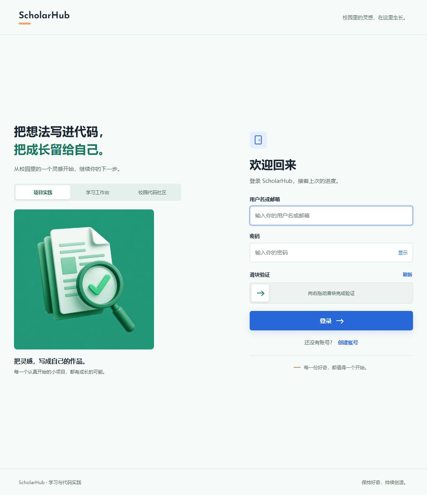
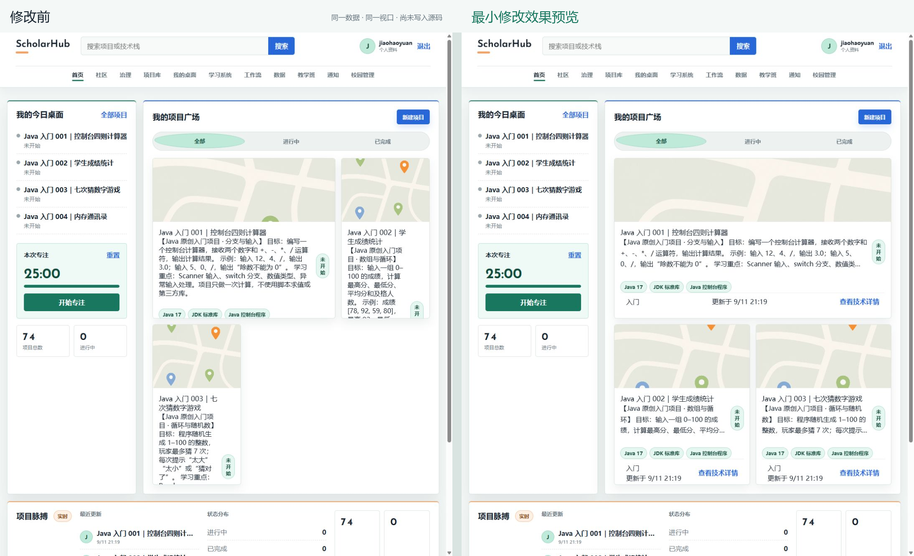
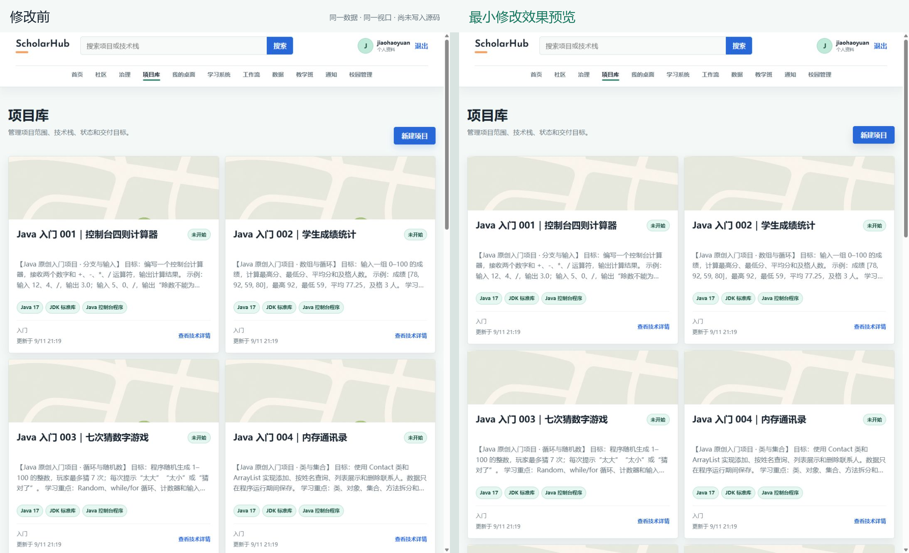
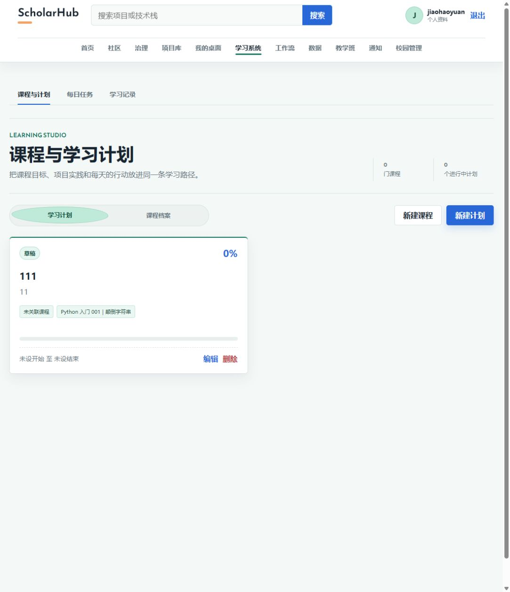
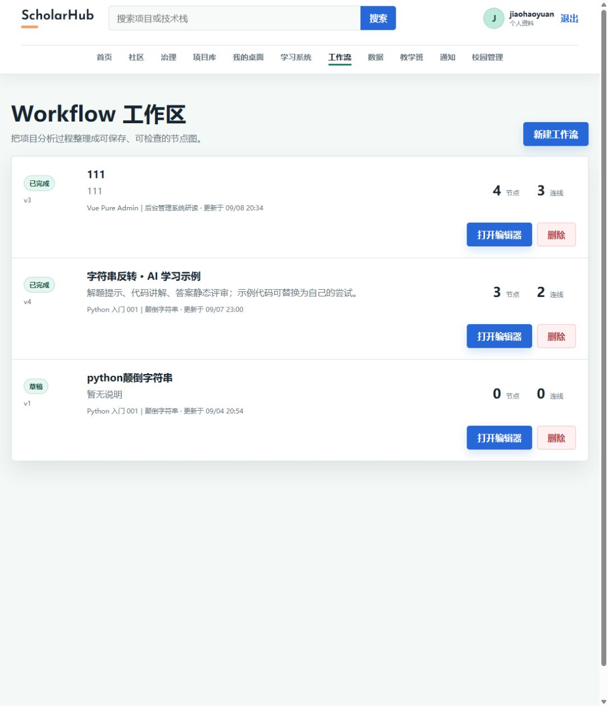
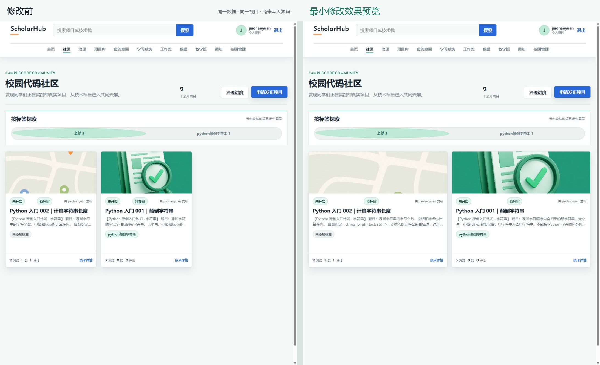
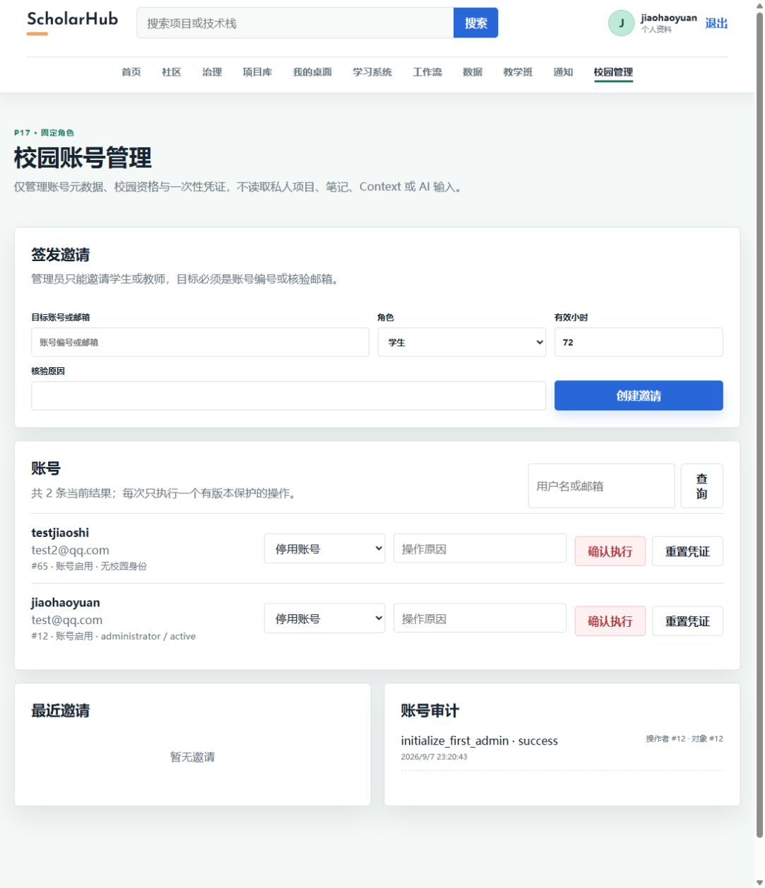
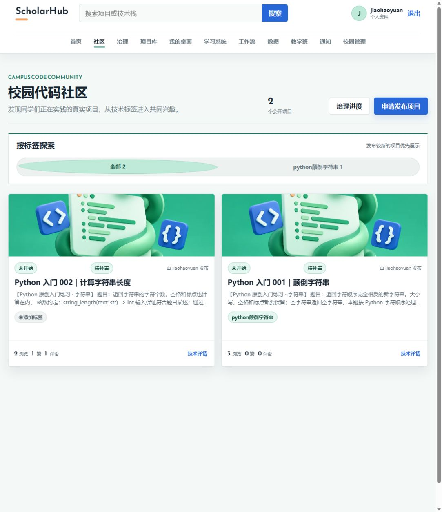

# ScholarHub 前端设计审查与最小修改方案

> 审查日期：2026-09-12
>
> 审查范围：登录、首页、项目库、学习计划、工作流、校园社区、校园账号管理及首页窄屏状态
> 当前状态：用户已确认并完成最小布局包与六类项目封面实施

## 1. 审查结论

当前原型已经具备统一的冷白、海沫绿、钴蓝视觉语言，页面结构和主要操作入口清楚，可以用于原型讲解。最需要优先处理的是首页项目卡片在中等宽度下的文字溢出；其次是社区低数量内容的栅格留白、项目封面与项目语言不匹配、部分文字按钮触控区域偏小，以及手机端顶部导航的后半部分不易发现。

本轮修改已在现有 Vue 3、Element Plus 和 CSS 体系内完成，没有新增项目依赖、修改公共 API、数据库或业务状态。

## 2. 页面检查记录

### 2.1 登录页：状态良好

- 表单标签、主按钮和辅助入口层级清楚。
- 插画与产品色彩一致，登录区域在桌面宽度下平衡。
- 页脚和辅助说明字号较小、对比较弱，可以保留到后续统一可访问性检查，不阻塞本次原型展示。

### 2.2 首页：需要优先修复

- 在约 1098 px 的中等桌面宽度下，项目区先变为两列，而项目卡片内部仍按三列布局。
- 置顶卡片占两列，其余卡片被压成窄列；项目描述没有正确截断，文字从卡片中溢出。
- 根因是通用样式选择器只匹配内容区的直接子元素，但实际描述位于内部容器中。

最小修改：直接为 `.project-flip-card__description` 增加三行截断，并在 921–1240 px 下改为两列；置顶卡片占满第一行，其余卡片各占一列。

### 2.3 项目库：结构良好，图片占比可降低

- 标题字号、描述行数和技术标签已经有清楚的规格。
- 封面高度和卡片最小高度偏大，首屏可见项目较少。
- 74 个项目循环使用 3 张封面；Java、C、Vue、Python 等项目经常出现与技术方向不相关的图片，影响快速识别。
- 当前三张封面约为 0.9–1.5 MB/张，后续新增分类封面时应同时控制尺寸和格式。

已把封面行从 154 px 调整为 132 px、卡片最小高度从 480 px 调整为 450 px，并补充 Python、Java、C、Vue、AI/工作流和通用项目六张轻量 WebP 分类封面。封面按项目名称、语言、框架、前端和后端字段匹配；未知类型使用通用封面。

### 2.4 学习计划：基本健康

- 计划摘要、今日任务和操作区分组清楚。
- 当前只有一条数据，页面下方留白较多，属于样本数量带来的自然状态。
- 卡片中的数字缺少更明确的单位或字段说明，属于内容表达问题，可在后续整理真实数据时调整。

### 2.5 工作流：状态良好

- 工作流名称、版本、状态、运行次数和操作排列清楚。
- 三条数据下的空白不会影响使用，不建议为了填满页面增加无意义内容。
- 个别测试数据使用“111”作为标题或说明，展示前应替换为有意义的样本内容。

### 2.6 校园社区：低数量内容时失衡

- 三列固定栅格在只有两条内容时留下完整空列，两张卡片只占页面约三分之二。
- 卡片的“技术详情”等文字操作区域实测约 48 × 16 px，键盘可见但触控区域偏小。

最小修改：宽屏使用 `repeat(auto-fit, minmax(300px, 1fr))`，让两条内容自动填满两列；为卡片文字操作增加 `inline-flex`、内边距和不小于 40–44 px 的点击高度。

### 2.7 校园账号管理：结构清楚

- 邀请、账号搜索和账号操作分区清楚，管理员操作能够在同一页面完成。
- 账号行右侧操作较密集，窄屏下需要继续观察换行和触控间距。
- 搜索框当前主要依赖占位文字表达用途；后续可补充可访问标签，不需要改变页面外观。

### 2.8 手机端首页：内容可读，导航发现性不足

- 390 × 844 视口下，内容卡片能够正常单列排列。
- 顶部区域约 176 px 高；导航可横向滚动，但可视宽度约 347 px、内容宽度约 694 px，后半入口没有明显提示。

最小修改：保留现有路由和横向导航，增加右侧渐隐提示、滚动吸附和明确的“可横滑”反馈。若后续希望更稳妥，再把低频校园入口收进一个可键盘操作的“更多”菜单；本轮不建议直接重构导航。

## 3. 建议实施顺序

| 优先级 | 问题 | 最小修改 | 影响文件 | 风险 |
| --- | --- | --- | --- | --- |
| P1 | 首页项目描述溢出、卡片过窄 | 修正描述选择器；中等宽度改两列 | `frontend/src/styles/main.css` | 低 |
| P1 | 社区文字操作点击区过小 | 仅给卡片操作补充高度与内边距 | `frontend/src/styles/main.css` | 低 |
| P2 | 社区两条内容留下空列 | 改为 `auto-fit` 响应式栅格 | `frontend/src/styles/main.css` | 低 |
| P2 | 项目封面占比偏大 | 缩短封面行和卡片最小高度 | `frontend/src/styles/main.css` | 低 |
| P2 | 封面与语言不匹配 | 新增分类封面并按现有字段映射 | `frontend/src/assets/projectCovers.ts`、静态资源 | 已确认并完成 |
| P2 | 手机导航后半入口不易发现 | 增加渐隐提示和滚动反馈 | 顶部导航组件与样式 | 低 |

## 4. 实施边界

用户已确认同时实施“最小布局包”和“分类封面包”。本轮完成首页溢出修复、社区自适应栅格、项目封面比例、文字操作点击区、手机导航提示和六类封面映射。

封面由内置 ImageGen 生成，随后使用工作区已有 Sharp 运行时转为 960 × 640、质量 82 的 WebP；单张约 15–40 KB。生成原图保留在 Codex 生成目录，项目引用的最终图片已放入前端静态资源目录。

## 5. 证据限制

- 截图来自本次启动后的真实本地页面和当前数据库数据。
- 01–11 为审查与临时预览证据；12–16 为实际源码实施后的真实页面截图。
- 已检查桌面与 390 px 窄屏；尚未执行真实手机、Safari、Firefox、完整屏幕阅读器或触控设备验收。
- 本地前端类型检查与生产构建通过；浏览器检查基于当前登录账号和真实本地数据，不代表跨浏览器验收。

## 6. 实施后证据

### 6.1 首页中等宽度布局

描述保持三行截断，置顶卡片占满第一行，其余项目稳定显示为两列。

### 6.2 项目库封面比例与 Java 分类

项目卡片高度降低，Java 项目稳定匹配 Java 封面。

### 6.3 Vue 与 Python 分类

同一页回读确认 Vue 项目匹配 Vue 封面、Python 项目匹配 Python 封面。

### 6.4 社区低数量布局

两条内容自动填满两列；按钮实测高度为 44 px，两张社区项目均匹配 Python 封面。

### 6.5 手机导航提示

390 × 844 视口保留全部入口，导航右侧以渐隐、被截断的下一项和横向滚动条共同提示可继续横滑。

