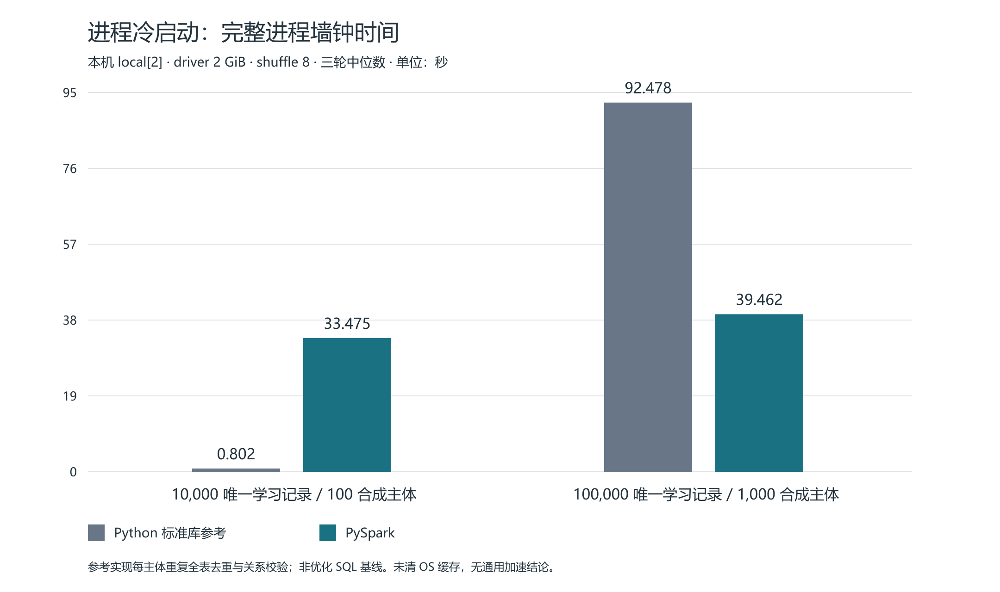
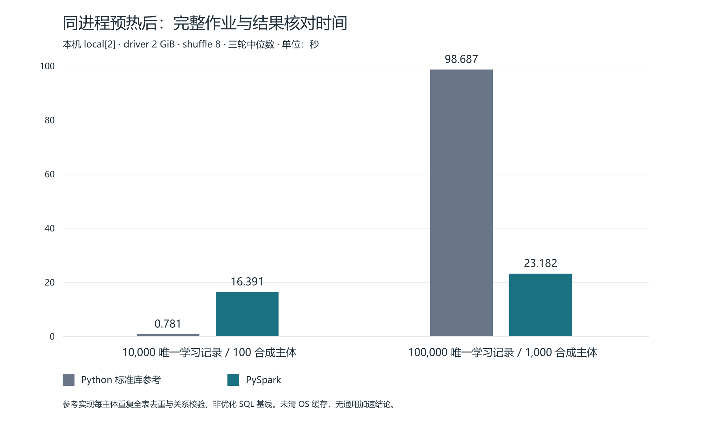

# S06 同口径规模实验结果

状态：**实验通过**。2026-10-21，在已有 WSL PySpark 4.2.0／Python 3.12.3／Java 17.0.20.1 下完成两档真实 Spark 与独立 Python 参考对照。每档、每引擎均为三次进程冷启动，另一个进程预热一轮后测量三轮；共 16 个子进程、28 轮，其中 24 轮正式测量、4 轮预热。所有进程退出码为 0，原始日志完整保留。

本实验结论仅覆盖离线指标计算、质量核对及本机性能。数据库发布、真实 HTTP 和浏览器主线证据由 S06 总报告另行提供。用户本轮选择真实模型调用为 0，J1 专题评分待完成；本实验通过不等于 S06 全部验收通过。

## 1 固定输入和独立答案

| 内容 | 1 万档 | 10 万档 |
| --- | ---: | ---: |
| dataset_id | synthetic-10000-v1 | synthetic-100000-v1 |
| snapshot_id | synthetic-10000-seed-20261020-v1 | synthetic-100000-seed-20261020-v1 |
| 唯一记录／物理记录 | 10,000／10,200 | 100,000／102,000 |
| 合成主体 | 100 | 1,000 |
| 全部 JSONL 输入字节 | 3,065,608 | 30,917,608 |
| 已知分钟 | 421,978 | 4,244,036 |
| 已知／缺失／已知零记录 | 8,000／2,000／1,000 | 80,000／20,000／10,000 |
| 完成任务／全部任务／取消 | 1,250／2,500／250 | 12,500／25,000／2,500 |
| 提交群组／修订／教师确认 | 100／30／60 | 1,000／300／600 |
| 每轮 Spark 全主体核对叶字段 | 36,436 | 364,264 |

生成种子为 `20261020`，窗口、分布与计时方法见 [实验方法](实验方法.md)。两个档位使用同一个 Linux 文件系统；一万档与 S03 原快照逐字节相同，十万档由既有生成器新建普通离线文件，未导入数据库。

独立预期先由未修改的 `analytics.fixture_answers.calculate` 读取相同输入、按全部主体核算，且核对生成器预先保存的汇总答案；之后 Spark 逐主体、逐字段和逐日对照，不以 Spark 自己生成的输出充当预期。整数、NULL、比例和字段集合精确一致，未舍入等待分钟仅允许 `1e-10` 浮点容差。14 个 Spark 轮次（包括预热）共执行 2,804,900 个叶字段比较，全部通过；这不是 280 万个独立案例或真实用户。

每轮复用 S04 质量规则、显式 schema、可信 ACCEPT 关联、DWD 和 Spark SQL ADS；质量 fatal 为 0、分流对账通过。结果包含记录／来源、任务分子分母、修订／确认／等待与每日细目。固定小样本的冲突拒绝、跨午夜、199／200、空集合等边界不混入性能主输入，其验收由 S04 和 S06 主线证据分别覆盖。

## 2 三轮原始值及中位数（秒）

“进程冷”包括子进程创建后的模块导入、Spark Session（如适用）、完整作业、核对与退出；“热”是同进程／同 JVM 预热后每次重新读取输入的完整作业和核对，不含预热与进程启动。两种边界分别比较，不能相加或混为同一个指标。

| 档位／引擎 | 冷1 | 冷2 | 冷3 | 冷中位 | 热1 | 热2 | 热3 | 热中位 |
| --- | ---: | ---: | ---: | ---: | ---: | ---: | ---: | ---: |
| 1万 Python | 0.802 | 0.805 | 0.786 | 0.802 | 0.782 | 0.769 | 0.781 | 0.781 |
| 1万 Spark | 32.388 | 33.475 | 35.359 | 33.475 | 17.054 | 16.385 | 16.391 | 16.391 |
| 10万 Python | 92.478 | 90.838 | 93.704 | 92.478 | 98.983 | 98.687 | 95.858 | 98.687 |
| 10万 Spark | 37.855 | 39.462 | 41.736 | 39.462 | 23.863 | 23.182 | 22.636 | 23.182 |

## 3 分项计时与资源

分项为各自三轮中位数，不能期望各分项中位数相加恰好等于完整轮次中位数。Spark“计算”包括质量检查、关系／事实物化和 ADS 收集；“输出等”是剩余的落盘及最终对账成本，不是仅磁盘写入。Python 与 Spark 分别输出 JSON 和 Parquet＋JSON，因此完整作业的产物成本有差别；计算值同时给出便于评估。

| 档位／引擎／轮次 | Session启动 | 输入读取 | 计算 | 输出等 | 独立核对 | 轮次完整 |
| --- | ---: | ---: | ---: | ---: | ---: | ---: |
| 1万 Python 冷 | — | 0.029 | 0.672 | 0.020 | 0.017 | 0.733 |
| 1万 Spark 冷 | 3.390 | 0.034 | 23.703 | 4.990 | 0.016 | 28.933 |
| 1万 Python 热 | — | 0.027 | 0.717 | 0.020 | 0.016 | 0.781 |
| 1万 Spark 热 | — | 0.025 | 13.097 | 3.261 | 0.014 | 16.391 |
| 10万 Python 冷 | — | 0.289 | 91.891 | 0.190 | 0.164 | 92.393 |
| 10万 Spark 冷 | 3.364 | 0.314 | 28.820 | 5.957 | 0.162 | 35.315 |
| 10万 Python 热 | — | 0.266 | 98.055 | 0.192 | 0.158 | 98.687 |
| 10万 Spark 热 | — | 0.262 | 18.680 | 4.051 | 0.155 | 23.182 |

Spark 均为 `local[2]`、driver `2g`、shuffle `8`、UTC session；不是生产集群。进程树 RSS 一秒采样，本档所有 Spark 进程的采样峰值最大值为：一万 `3,471,532,032` 字节（约 3.23 GiB），十万 `3,917,783,040` 字节（约 3.65 GiB）。WSL MemTotal 为 `8,215,748,608` 字节。RSS 和包含 Python／JVM／workers，可能重复计入共享页，不能解释为 Java 堆。

一万 Python 冷进程小于一秒，通常只有一次 RSS 样本，容易错过真正峰值；不能据其约 15MB 的采样值推出内存优势倍数。十万 Python 的进程级采样峰值最大值为 `235,118,592` 字节；所有轮次采样数与原始字节值保留在 JSON／CSV。

## 4 可以支持的结论

在一万档，标准库参考明显更快，Spark 的启动、调度和完整质量／Parquet 产物成本占主要部分。热运行降低 Spark 的本机固定开销，但仍不能在一万档取得速度优势。

在十万档，当前 Spark 实现比当前独立参考耗时低。然而参考程序每个主体重复全表去重、关系核对，并在关系验证中多次扫描版本；主体与记录同时增长放大了其工作量。这个结果只比较这两份实际实现，**不能外推为 Spark 比优化 Python、SQL 或 MySQL 普遍更快**，也不提供预设加速倍数。后续若比较优化实现，应以新的实验身份保留本轮原始结果。

Spark 输入目前仍由 Python 驱动完整读入 JSONL，再建立 DataFrame；本轮是约 3MB／31MB 的单机实验，没有证明超过驱动内存的读取能力、百万档或集群扩展。合成种子与规则用于计算可重复性，不证明真实学习用户分布或教学成效。没有控制 OS 页缓存、CPU 频率、系统后台进程或热状态，三轮中位数只是本次实测，不是性能置信区间。

## 5 证据和恢复

- [一万完整汇总](n10000-summary.json)、[十万完整汇总](n100000-summary.json)：16 个子进程的命令、退出码、轮次、参数、RSS 和全部分项。
- [产物核对](qa.json)：16 个进程退出码、24 个测量轮／4 个预热轮、14 个真实 Spark 完成任务、参数、质量对账、原一万快照字节一致及两张 PNG 尺寸均通过。
- [全部28轮CSV](all-rounds.csv)：含4轮预热，`measured=false`；热进程的 `external_process_seconds` 是整个预热＋3热进程时间，不能当某一轮时间。
- [冷进程SVG](process-cold-median.svg)、[热轮SVG](hot-round-median.svg) 及同名 PNG，可直接作为论文图表素材；图片已经渲染并目视核对标签、数值和布局。
- `inputs/snapshots/`：固定 JSONL／manifest；`runs/`：每次独立 Python 答案、Spark DWD／ADS、manifest、quality、原始 stdout/stderr 和进程元数据；完成目录均保留，不覆盖旧 S03/S04 任务。
- [导出脚本](export_results.py)：从完成汇总生成 CSV 和 SVG，不运行 Spark；PNG 使用既有 bundled sharp 渲染，未安装依赖。

所有正式实验进程退出 0；没有需要隐藏或重算的失败。日志中 hostname、native-Hadoop fallback 等环境警告原样保留，未通过改系统配置压制。所有 Spark Session 已停止；WSL 和 MySQL 服务保持原状，数据库和模型调用均为 0。百万档和集群实验未选择，未冒充完成；本轮没有继续后续阶段。

WSL 原件为 `/home/administrator/scholarhub-analytics/s06-20261021`，完整输入／任务及日志已复制到本目录，复制时无覆盖已有目的目录。撤销仅针对本轮新增 `analytics/benchmark_s06.py` 和本目录；旧输入与旧任务无需恢复。
